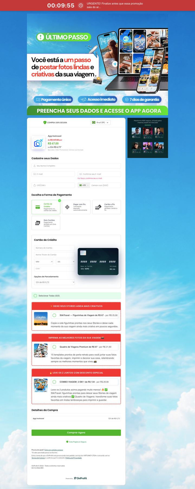
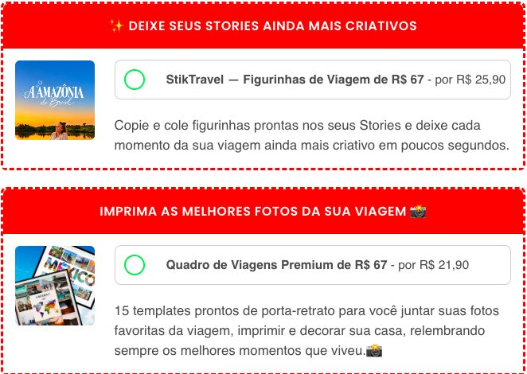
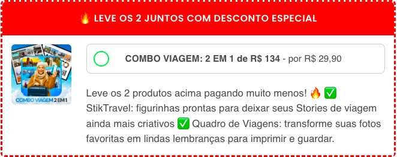

# Playbook do checkout low ticket

**Versão 1 · 04/11/2026.** Modelo: checkout do **Instravel** (Kamila Fontana, OnProfit), a partir dos prints do Paulo. Irmão do `playbook-pagina-lt.md`: a página faz a pessoa decidir; o checkout faz ela **não desistir** e **levar mais**.

- Prints originais: `.claude/skills/low-ticket/fontes/4-conhecimento/cursos-e-sistemas/Low Ticket Kamilla/Página de Vendas/referencia-instravel/prints-paulo/LT - Kamilla -  instravel - Checkout/`
- Prompts de todas as imagens (banner, bumps, mockups): `prompts-imagens-lt.md`
- Skills: `lt-banner-checkout` (banner), `lt-oferta` (bumps e combo)

---

## 1. O checkout em uma tela

De cima para baixo:

| # | Elemento | Função |
|---|---|---|
| 1 | Faixa vermelha fixa: cronômetro + "URGENTE! Finalize antes que essa promoção saia do ar..." | Pressa (pode usar: a oferta é daquela visita) |
| 2 | Banner "ÚLTIMO PASSO" | Lembrar a promessa e dizer o que fazer agora |
| 3 | Cartão do produto: ícone do app, "App Instravel", ~~de R$ 147,00~~ por **R$ 67,00**, ou 12x R$ 6,73 | Confirmar o que está comprando e o preço que viu na página |
| 4 | Formulário: nome, e-mail + confirmação, CPF, celular | O mínimo. Confirmar e-mail evita acesso perdido (suporte) |
| 5 | Pagamento: Cartão (já marcado), Pix, Cartão + Pix, Dois cartões | Ninguém fica sem forma de pagar |
| 6 | Parcelamento já em **12x de R$ 6,73** | O número pequeno é o que aparece primeiro |
| 7 | "Selecionar todas (0/3)" | Atalho para quem quer tudo |
| 8 | Order bump 1, bump 2, combo | Aumentar o valor do pedido |
| 9 | Detalhes da compra + botão verde "Comprar Agora" | Fechar |
| 10 | Ao lado: "Plataforma 100% segura, utilizada pelos maiores players do mercado" + fotos | Prova da plataforma (não do produto) |
| 11 | Fundo: **o mesmo céu da página** | A pessoa sente que não saiu do lugar |

**Continuidade é a regra número 1:** mesmo fundo, mesmo mockup, mesma frase da página ("Você está a um passo de..."), mesmo preço, mesmas 3 garantias. Qualquer diferença entre página e checkout gera desconfiança na hora do cartão.

---

## 2. O banner

| Bloco | Instravel | Por quê |
|---|---|---|
| Fundo | Foto do céu com nuvens (o "mundo do nicho", igual à página) | Continuidade visual |
| Selo | Pílula verde com "!" : **ÚLTIMO PASSO** | Diz que falta pouco (efeito de quase terminado) |
| Cartão da headline | Cartão branco colado à esquerda: "Você está a **um passo** de **postar fotos lindas** e **criativas** da sua viagem." (destaques em laranja) | É a promessa da headline com "Você está a um passo de" na frente. A pessoa lê a mesma coisa pela terceira vez |
| Enfeites | Avião ✈️ saindo do cartão, câmera 📸 com brilho | Emojis do nicho em 3D, dão vida sem poluir |
| Produto | Notebook + 2 celulares com as telas reais do app (o mesmo mockup da oferta) | "É isso que você vai receber em segundos" |
| Selos | 3 pílulas azuis: Pagamento único · Acesso imediato · 7 dias de garantia | Os 3 medos da hora de pagar: cobrança, espera, risco |
| Barra | Verde, largura toda: **PREENCHA SEUS DADOS E ACESSE O APP AGORA** | Instrução clara do próximo passo (não é mais venda) |

**O que mudou em relação ao modelo antigo (50 Viral Fit, que está na `lt-banner-checkout`):**
- Fundo cinza claro → fundo do mundo do nicho (o mesmo da página).
- Selos pretos com verde neon → selos na cor da marca (azul), mais leves.
- Barra "FINALIZE SEUS DADOS E ACESSE AGORA" → "PREENCHA SEUS DADOS E ACESSE **O APP** AGORA" (diz o nome do que vai receber).
- Celulares sozinhos → notebook + celulares (mostra que funciona nos dois).
- Sem logo no banner (o ícone do app aparece no cartão do produto logo abaixo).

Formato: 1024 x 736 (quase 4:3), horizontal. No celular ocupa a largura toda: o texto precisa ser grande.

---

## 3. Order bumps: por que existem e por que não são bônus

### 3.1 Bônus x order bump (a diferença que decide tudo)

| | Bônus | Order bump |
|---|---|---|
| Para que serve | Tirar uma **objeção** da compra principal | Atender uma **vontade a mais** de quem já decidiu |
| Pergunta que responde | "E se eu não conseguir?" (medo) | "E se ficar ainda melhor?" (desejo) |
| Sem ele, a promessa se cumpre? | **Não** para parte do público | **Sim**, ela se cumpre igual |
| Onde aparece | Na página, antes do preço | No checkout, depois da decisão |
| Preço | Grátis (sobe o valor percebido) | Pago, barato (sobe o valor do pedido) |
| O que mede | Taxa de conversão da página | Ticket médio (quanto cada cliente paga) |

**Teste de duas perguntas** para decidir onde cada item vai:
1. "Se eu tirar isso, a promessa da headline ainda acontece?" Não → é **bônus** (ou parte do produto). Sim → pode ser **bump**.
2. "Isso responde a um medo ou a uma vontade?" Medo → bônus. Vontade → bump.

Aplicando no Instravel:
- **Inspirações de Fotos** é bônus: quem não sabe fotografar não consegue "postar fotos lindas". Sem ele, a promessa falha.
- **Tutorial** é bônus: quem não sabe mexer no Canva trava. Medo.
- **Figurinhas (StikTravel)** é bump: o Story já fica lindo sem elas. É "ainda mais criativo". Vontade.
- **Quadro de Viagens** é bump: imprimir não tem nada a ver com postar. É levar a viagem para outro lugar. Vontade.

**Por que não colocar os bumps como bônus?** Porque bônus demais na página não aumenta a venda (a pessoa já decidiu com 3) e o produto perde a chance de cobrar por eles. No checkout, quem já está com o cartão na mão diz sim mais fácil: a decisão grande já foi tomada, o bump é uma decisão pequena e de impulso.

**Por que não colocar os bumps na página?** Porque cada produto a mais na página é mais uma coisa para pensar antes da decisão principal. A página vende uma coisa só.

### 3.2 Os 3 itens e a ordem

| Ordem | Cabeçalho (benefício) | Produto | Preço | Ligação com o principal |
|---|---|---|---|---|
| 1 | ✨ DEIXE SEUS STORIES AINDA MAIS CRIATIVOS | StikTravel: Figurinhas de Viagem | de R$ 67 por **R$ 25,90** | Mesmo uso, mesmo momento (o Story que ela vai postar) |
| 2 | IMPRIMA AS MELHORES FOTOS DA SUA VIAGEM 📸 | Quadro de Viagens Premium | de R$ 67 por **R$ 21,90** | Mesma viagem, outro uso (fora do Instagram, em casa) |
| 3 | 🔥 LEVE OS 2 JUNTOS COM DESCONTO ESPECIAL | COMBO VIAGEM: 2 em 1 | de R$ 134 por **R$ 29,90** | Os dois acima |

**Por que essa ordem:**
1. **Primeiro o mais próximo do produto principal.** Figurinhas completam exatamente o que ela acabou de comprar (o Story). É o "sim" mais fácil. Também é o mais caro dos dois (R$ 25,90): quem aceita aqui aceita o maior valor.
2. **Depois um uso diferente e mais barato.** O quadro abre um desejo novo (decorar a casa com a viagem) e custa menos (R$ 21,90): quem recusou o primeiro tem uma segunda porta, mais barata.
3. **O combo por último.** Ele só faz sentido depois de ver os dois preços (25,90 + 21,90 = 47,80). Aí "os 2 por R$ 29,90" parece óbvio. É o bump que mais vende para quem já se interessou por um dos dois. Se viesse antes, a pessoa não teria a conta na cabeça.

**Por que o "de R$ 67" em cada bump:** é o mesmo preço do produto principal. Passa a ideia de "isto é um produto do mesmo tamanho que o que você comprou, por um terço".

### 3.3 Como cada bump é escrito

- **Cabeçalho (faixa vermelha):** verbo no imperativo + benefício + emoji. Nunca o nome do produto. "DEIXE SEUS STORIES AINDA MAIS CRIATIVOS", "IMPRIMA AS MELHORES FOTOS DA SUA VIAGEM".
- **Linha da caixinha:** nome do produto (marca própria curta: StikTravel) + "de R$ X - por R$ Y".
- **Descrição (1 a 2 frases):** o que é, concreto, com número quando tem + o resultado emocional.
  - "Copie e cole figurinhas prontas nos seus Stories e deixe cada momento da sua viagem ainda mais criativo em poucos segundos." (facilidade + "poucos segundos", os mesmos pilares da promessa principal)
  - "15 templates prontos de porta-retrato para você juntar suas fotos favoritas da viagem, imprimir e decorar sua casa, relembrando sempre os melhores momentos que viveu. 📸" (número + uso + emoção)
  - Combo: "Leve os 2 produtos acima pagando muito menos! 🔥 ✅ [produto 1: benefício] ✅ [produto 2: benefício]"
- **Imagem:** quadrado pequeno à esquerda, mostrando o produto (prompts em `prompts-imagens-lt.md`).
- **Visual:** borda vermelha tracejada + faixa vermelha. Chama atenção dentro de um formulário todo branco.

### 3.4 Como criar os bumps de uma oferta nova

1. Liste o que o cliente vai querer **depois** de usar o produto principal: no mesmo uso ("ainda mais...") e em outro uso da mesma vida (outro lugar, outro formato, outra pessoa).
2. Passe cada ideia no teste de duas perguntas (3.1). Só fica o que for vontade, não medo.
3. Escolha 2: o primeiro grudado no uso principal (mais caro), o segundo em outro uso (mais barato).
4. Faça o combo dos 2 por pouco mais que o mais caro (Instravel: R$ 29,90 contra R$ 25,90).
5. Âncora de cada bump = preço do produto principal. Âncora do combo = soma das âncoras.
6. Cada bump é de consumo rápido e pronto (templates, figurinhas, lista, planilha), igual ao principal.
7. Os bumps são a ponta da **esteira**: o que vende bem como bump vira candidato a produto próprio ou upsell (anote a taxa de cada um).

**Duas tabelas de preço válidas** (escolha uma por oferta):
- Kamila padrão (`lt-oferta`): 3 bumps de R$ 15,90 a R$ 17,90 + combo 3 em 1 (produto de R$ 67 → combo R$ 35,90).
- Instravel: 2 bumps de R$ 21,90 e R$ 25,90 + combo 2 em 1 a R$ 29,90. Menos produto para criar, bumps mais caros.

---

## 4. Cuidados

- **Cronômetro de 10 min no checkout:** pode usar. Vale a mesma regra da página: a oferta é daquela visita (playbook da página, seção 5).
- **"Plataforma utilizada pelos maiores players do mercado"** com fotos: é material da OnProfit, vem pronto da plataforma.
- O resto (banner, bumps, combo, continuidade, parcela em destaque) é para usar.

## 5. Não visto ainda

O mapa do que vem depois da compra (upsell, downsell, área de membros, qualificação, call, mentoria e a recuperação em 5 min, 24 h e 7 dias) está em `playbook-funil-escala-lt.md`, a partir dos slides da aula. Ainda faltam prints reais das páginas de upsell e downsell e do e-mail de acesso. Se o Paulo comprar ou tiver os prints, completar aqui.

## 6. Checklist do checkout de uma oferta nova

- [ ] Fundo do checkout = fundo/mundo da página
- [ ] Banner: "ÚLTIMO PASSO" + "Você está a um passo de [promessa da headline]" + mockup da oferta + 3 garantias reais + barra "PREENCHA SEUS DADOS E ACESSE [O PRODUTO] AGORA"
- [ ] Cartão do produto com o mesmo de/por e parcela da página
- [ ] Parcelamento máximo já selecionado
- [ ] 2 bumps (ou 3) + combo, cabeçalho de benefício, ordem: mais próximo e mais caro → outro uso e mais barato → combo
- [ ] Imagem quadrada de cada bump
- [ ] Cronômetro: por visitante (ao zerar, nada muda) ou por data real
- [ ] Testar a compra no celular antes de subir anúncio
