# Playbook visual dos criativos em vídeo low ticket

**Versão 1 · 04/11/2026.** Complemento do que **já existe**, sem repetir:
- **Método e roteiro** (6 etapas, ganchos, CTA, takes, PDF de gravação): skill `lt-criativos-video` e `padroes-kamilla.md` · processo `.claude/skills/low-ticket/fontes/0-vissia/operacao/processos/criativos-video-low-ticket.md`.
- **Produto:** Meu Roteiro que Vende (`.claude/skills/low-ticket/fontes/3-produtos/meu-roteiro-que-vende/`): Engenharia do Minuto e as 6 Decisões do Desconhecido.
- **Padrão ouro nosso:** Anúncio Pronto (`.claude/skills/low-ticket/fontes/1-clientes/primeiro-cnpj/5-produtos/anuncio-pronto/criativo/`), formato por takes aprovado em 01/11/2026.

**O que este playbook acrescenta:** o lado **visual** dos 11 anúncios reais da Kamila, que ainda não estava registrado: os formatos de tela, as aberturas, as legendas e o cartão final, as provas que aparecem na tela e o desmonte de cada vídeo com os quadros. Serve para escrever a coluna **"Na edição"** e o campo **"quebra"** dos takes, e para a `/editar-criativo`.

Vídeos: `.claude/skills/low-ticket/fontes/4-conhecimento/cursos-e-sistemas/Low Ticket Kamilla/Criativos/` · Quadros: `playbook/img/cv-*.jpg`. Nota de ritmo: ela fala cerca de 3 palavras por segundo; no nosso formato o alvo aprovado segue 120 a 150 palavras para 50 a 60 s.

## 1. Os 5 formatos visuais (o que se vê na tela)

| Formato | Como é | Vídeos | Quando usar |
|---|---|---|---|
| **A. Pessoa recortada no canto** | A pessoa, recortada com contorno colorido ou tracejado, ocupa o canto de baixo (cerca de 45% da tela), na frente de um fundo que troca a cada 3 s: exemplos do produto, telas do app, posts com curtidas | 50VF 271, criativos 3, 4, 5, 6, 8, 10 | **O padrão.** Produto que dá para mostrar (modelos, app, IA) |
| **B. Tela dividida** | Em cima, um exemplo do que o produto faz (um Reels viral) com faixa vermelha de texto; embaixo, a pessoa falando | 50VF 272 | Quando o exemplo é o argumento ("é esse formato que viraliza") |
| **C. Personagem em 3ª pessoa** | Várias cenas de vida (almoço, sofá, rede, notebook), roupas trocadas, recorte com nome ("Esta é Kamila"), notificação de venda, legenda de 2 linhas | Criativo 7 | História de transformação de alguém real |
| **D. Cabeça falante com texto 3D** | A pessoa sentada falando direto; no começo um texto grande 3D ("Low Ticket") e uma notificação; depois tela em cima e pessoa embaixo | Criativo 9 | Explicação, tutorial, autoridade |
| **E. Tela pura** | Filmagem da tela do computador ou do celular mostrando o produto funcionando; termina com o resultado | Criativo 11 | Produto que se prova sozinho na tela (IA, gerador) |

Em todos: **corte ou troca de fundo a cada 3 a 4 segundos**. Nada fica parado.

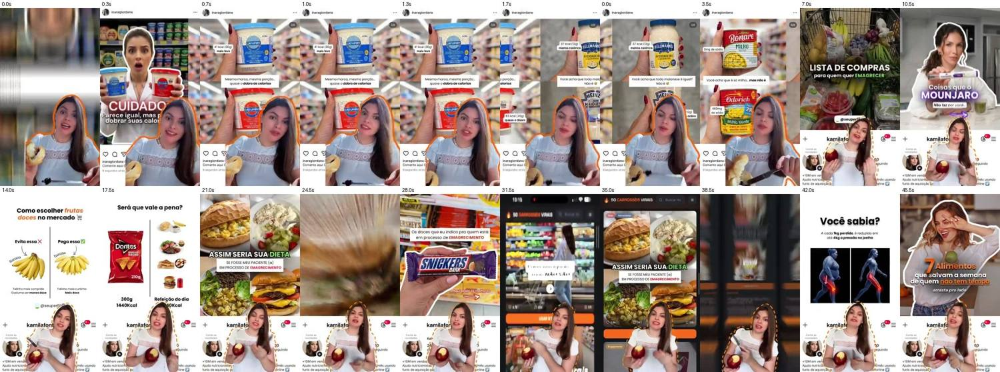

---

## 2. As aberturas (quebra de padrão): 11 jeitos que ela usa

| Abertura | O que acontece nos 2 primeiros segundos | Vídeo |
|---|---|---|
| Transição com desfoque | Um "whoosh" borrado vira a cena; a pessoa recortada já falando | 50VF 271, criativos 4, 5, 6 |
| Comendo algo | Maçã, banana, pão na mão enquanto fala (casual, gente de verdade) | 50VF 271, 272 |
| Faixa de público no topo | Cartão tipo notificação: "Exclusivo para mulheres cristãs · Assista este vídeo até o final" | Criativo 3 |
| Objeto na mão | Copo térmico, notebook, celular colado na câmera | Criativos 3, 6, 11 |
| Gesto no rosto | Dedo na têmpora ou na bochecha, pose de "pensa comigo" | Criativos 4, 5, 10 |
| Entrar andando | Entra no quadro carregando o notebook | Criativo 6 |
| Texto que se monta | Letras recortadas montando a pergunta ("Contenido listo para Instagram?") | Criativo 6 |
| Recorte com nome | Contorno laranja grosso, estrelas e "Esta es Kamila" | Criativo 7 |
| Recorte sobre estética do nicho | Contorno branco, bilhete de papel com a frase, adesivos de flor | Criativo 8 |
| Texto 3D + notificação | "Low Ticket" verde neon gigante e uma notificação aparecendo | Criativo 9 |
| Bastidor | O celular no tripé gravando, a pessoa no fundo | Criativo 10 |

Regra: **a quebra é o que se vê; o gancho é o que se ouve; os dois juntos no segundo 0.**

---

## 3. Legendas, textos e edição

**Legenda (sempre, palavra por palavra):**

| Estilo | Como é | Vídeos |
|---|---|---|
| Palavra única no centro | Uma palavra por vez, branca, grossa, com contorno escuro, no meio da tela | Criativos 4, 5, 10 |
| Palavra em caixa colorida | Uma palavra em caixa amarela ou laranja, levemente girada | Criativos 8, 9 |
| Duas linhas com destaque | Frase curta em 2 linhas brancas, a palavra-chave colorida (rosa, amarelo, azul) | Criativo 7 |
| Brilho | Palavra amarela com brilho | Criativo 11 |

**O que se sobrepõe:** faixa de texto do público no topo; notificação (venda, Pix, mensagem); posts com curtidas e comentários; telas de "insights"; recorte da pessoa com contorno; adesivos do nicho; seta apontando para baixo no CTA.

**Cartão final:** tela preta com "CLIQUE EM SAIBA MAIS" em caixa branca e setas para baixo (criativos 5, 10, 11), ou a frase com seta desenhada (criativo 6), ou a cena com moldura de câmera "REC" (criativo 7). Fica 2 a 3 s.

**Ritmo de edição:** troca de fundo a cada 3 a 4 s, transições com desfoque, a pessoa recortada fica fixa no canto enquanto o fundo muda. Tudo isso é o estilo da `/editar-criativo`.

---

## 4. Prova: o que ela usa e o que podemos usar

| Prova | Exemplo | Na Vissia |
|---|---|---|
| Demonstração na tela | O app gerando, o clone falando, o carrossel sendo baixado | **Sempre.** É a prova principal |
| Quantidade | "Olha a quantidade de modelos", galeria passando | Sim |
| Metaprova | "Esse vídeo que você está vendo foi 100% feito com essa IA" | Só se for verdade **e** não confundir (erro já cometido: parecer que o anúncio inteiro é IA) |
| Prints de redes | Posts com curtidas, comentários, insights | Sim, se forem reais |
| Notificações de venda ou Pix | "Venta realizada", "Pix Pago Você recebeu R$ 17,90" | Sim, as nossas reais |
| Relato em 1ª pessoa | "As pessoas compartilham, mulheres escrevem para mim" | Sim, o que a especialista viveu |

---

## 5. Os 11 vídeos desmontados

### 50 Viral Fit 271 · Contraintuitivo · formato A · 49 s · 160 palavras

- **Abertura:** desfoque vira a cena; recortada comendo pão no mercado, por cima de um carrossel "CUIDADO" de comparação de produtos.
- **Gancho:** "Não faz sentido, mas é esse formato aqui de carrossel orgânico que tá fazendo os nutricionistas viralizar."
- **Dor/explicação:** por que o formato viraliza (identificação com marcas do mercado, nativo do Instagram).
- **Solução + prova:** "Aqui ó, nessa biblioteca você tem 50 modelos prontos" com a biblioteca na tela; "E o melhor: cada modelo já vem com a legenda".
- **CTA:** duplo, "libera o seu acesso".
- **Por que funciona:** o próprio produto é o gancho (o carrossel que aparece é um dos modelos). O fundo troca a cada 3 s mostrando 10 carrosséis diferentes: prova de quantidade sem dizer nada.

### 50 Viral Fit 272 · Diagnóstico · formato B · 34 s · 107 palavras
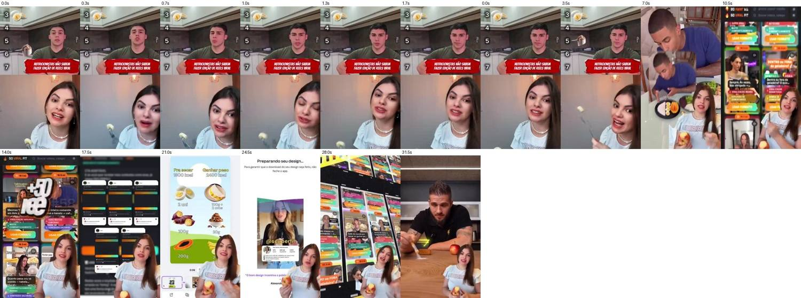
- **Abertura:** tela dividida: em cima, um Reels viral de outro nutricionista com a faixa vermelha "NUTRICIONISTAS NÃO SABEM FAZER EDIÇÃO DE REELS VIRAL"; embaixo, ela comendo banana.
- **Gancho:** "A maioria dos nutricionistas que não viralizam é porque não sabem fazer essas edições aqui."
- **Solução:** "Aqui, nessa biblioteca, estão os 50 Reels mais viralizados do seu nicho"; "com apenas um clique você gera o roteiro"; "É só trocar o fundo, baixar e postar."
- **Por que funciona:** mostra o resultado (o Reels viral) antes de falar do produto. Curto e direto. (34 s: no limite; para nós, mínimo 35 s.)

### Criativo 3 · Propósito · formato A · 53 s · 146 palavras
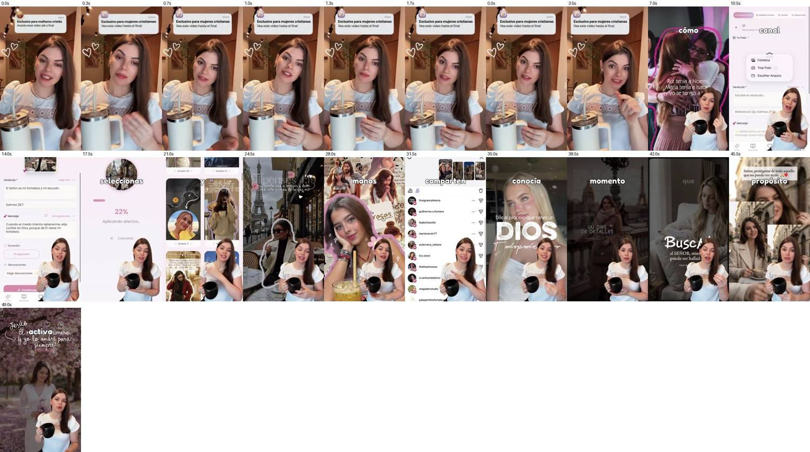
- **Abertura:** cartão de notificação no topo "Exclusivo para mulheres cristãs · Assista este vídeo até o final", copo térmico na mão, corações desenhados.
- **Gancho:** "A palavra de Deus tem poder e pode chegar a muito mais pessoas através das suas histórias."
- **Dor:** "Durante muito tempo eu quis começar a publicar, mas não sabia fazer stories bonitos."
- **Solução:** passo a passo na tela do app (escolhe o estilo, a foto, o versículo, a mensagem).
- **Prova:** relato (as pessoas reagem, compartilham, escrevem) + "Olha esses modelos, um mais lindo que o outro".
- **CTA:** "Se você sente que suas redes podem ser usadas para um propósito maior..." + ativar o acesso.
- **Por que funciona:** vende identidade e propósito, não ferramenta. Legenda palavra por palavra e fundos estéticos do nicho.

### Criativo 4 · Antes e depois · formato A · 50 s · 168 palavras
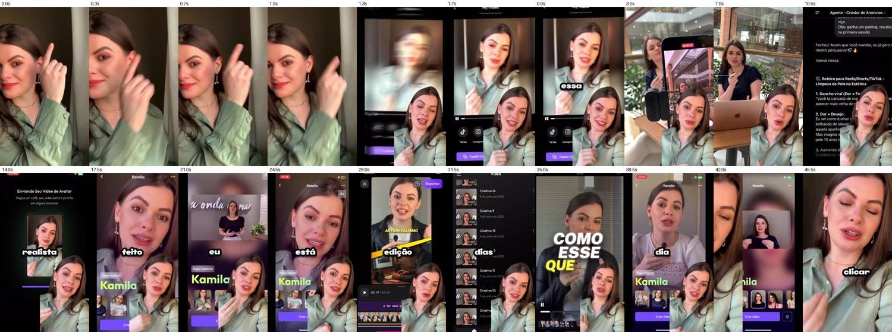
- **Abertura:** dedo na têmpora, close; desfoque; recortada na frente da tela do app.
- **Gancho:** "Depois que eu comecei a usar essa IA para gerar os meus anúncios, nunca mais perdi tempo e dinheiro com cenário, roteiro, gravação ou edição."
- **Prova:** metaprova ("esse vídeo foi 100% feito com essa IA"), a lista de clones que ela usa, o app gerando.
- **Por que funciona:** a dor está dentro do gancho (lista de 4 coisas chatas). A prova é o próprio vídeo.

### Criativo 5 · Pergunta com dor · formato A · 38 s · 113 palavras
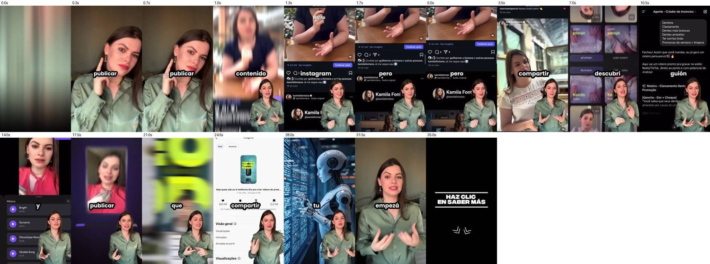
- **Abertura:** desfoque, gesto apontando para a têmpora, palavras únicas no centro.
- **Gancho:** "Quer publicar conteúdo no Instagram, mas tem pavor de gravar?"
- **Dor:** "Eu queria aparecer, mas a câmera me paralisava." **Virada:** "Até que eu descobri esta IA."
- **Fecho:** cartão preto "CLIQUE EM SAIBA MAIS".
- **Por que funciona:** dor emocional (medo da câmera) nomeada em 1 frase; solução que tira o esforço todo.

### Criativo 6 · Hipótese · formato A · 55 s · 146 palavras
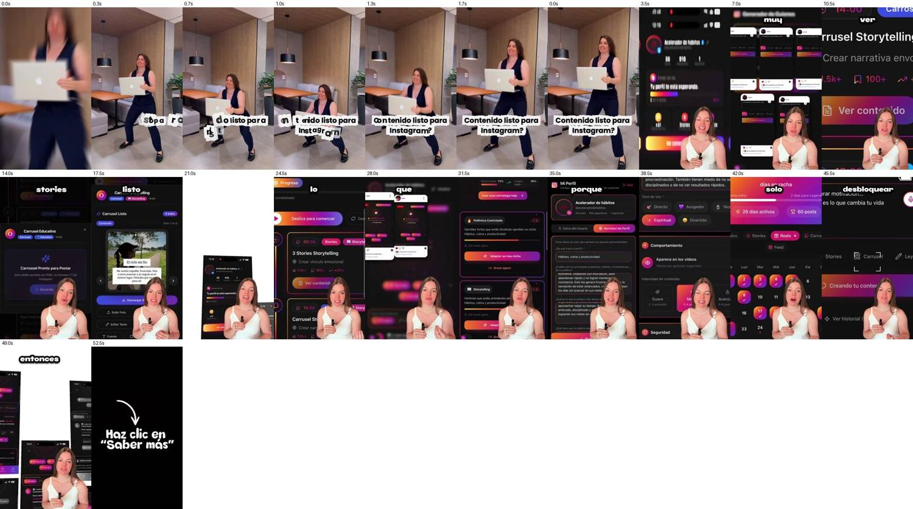
- **Abertura:** entra andando com o notebook; letras recortadas montam "Conteúdo pronto para Instagram?".
- **Solução:** "É muito simples: abre o app, clica em Ver Conteúdo e depois em Gerar"; lista do que entrega (Stories, Reels, Carrosséis, Posts); cronograma diário.
- **"E o melhor":** funciona para qualquer nicho.
- **Por que funciona:** demonstração longa e organizada, telas escuras do app com destaque rosa; microfone de lapela na mão (bastidor real).

### Criativo 7 · Terceira pessoa · formato C · 40 s · 148 palavras
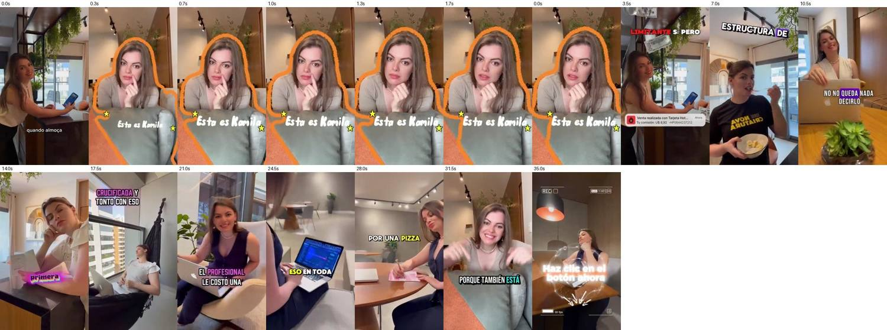
- **Abertura:** cena no balcão com o celular ("quando almoça"), depois o recorte laranja com "Esta es Kamila" e estrelas.
- **Gancho:** "Esta é a Kamila. Ela vende todos os dias no automático."
- **Desenvolvimento:** humor ("Irritante? Sim, mas funciona"), o "segredo" (estrutura de oferta validada), o que entrega, preço comparado a uma pizza.
- **CTA:** "antes que a Kamila tire este vídeo do ar". Pode usar (seção 7): o anúncio pode mesmo sair do ar.
- **Por que funciona:** narrador fala dela como personagem, várias cenas de vida, legenda em 2 linhas com palavra colorida: parece conteúdo, não anúncio.

### Criativo 8 · Pergunta com dor · formato A (estética do nicho) · 41 s · 132 palavras
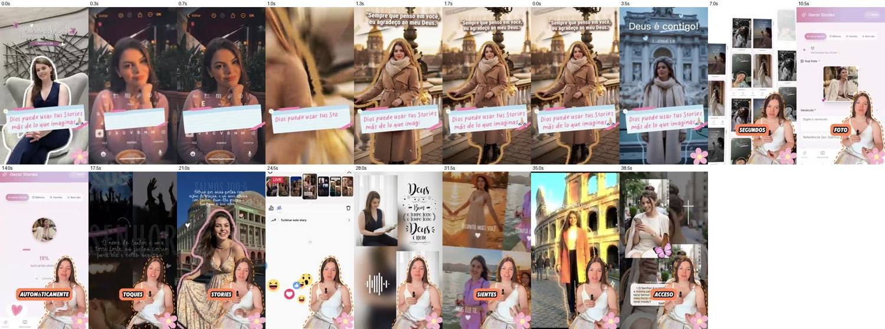
- **Abertura:** recorte com contorno branco sobre um story estético, bilhete de papel "Deus pode usar seus Stories mais do que você imagina", adesivos de flor; teclado digitando.
- **Gancho:** "Você deseja compartilhar a palavra de Deus, mas nunca tem tempo para preparar algo bonito?"
- **Solução e prova:** passo a passo no app, gerando "automaticamente"; reações de Stories; "Olha esses modelos, um mais lindo que o outro".
- **Por que funciona:** o visual inteiro está no mundo do nicho (cores, adesivos, fundos dos próprios modelos). Legenda em pílula laranja.

### Criativo 9 · Curiosidade · formato D · 61 s · 230 palavras
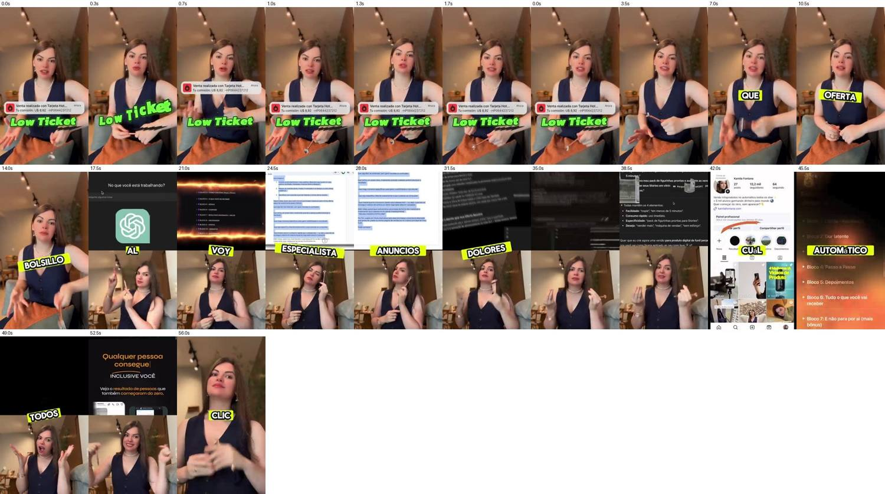
- **Abertura:** "Low Ticket" 3D verde neon gigante e notificação de venda aparecendo.
- **Desenvolvimento:** contra-crença ("o que vende não é o produto, é a oferta"), tutorial no ChatGPT na metade de cima, prova pelo perfil dela.
- **Renda:** fala de valor por mês e "dinheiro no bolso". Pode usar com número real (seção 7), com uma versão sem renda de reserva.

### Criativo 10 · Dor + virada · formato A · 67 s · 168 palavras
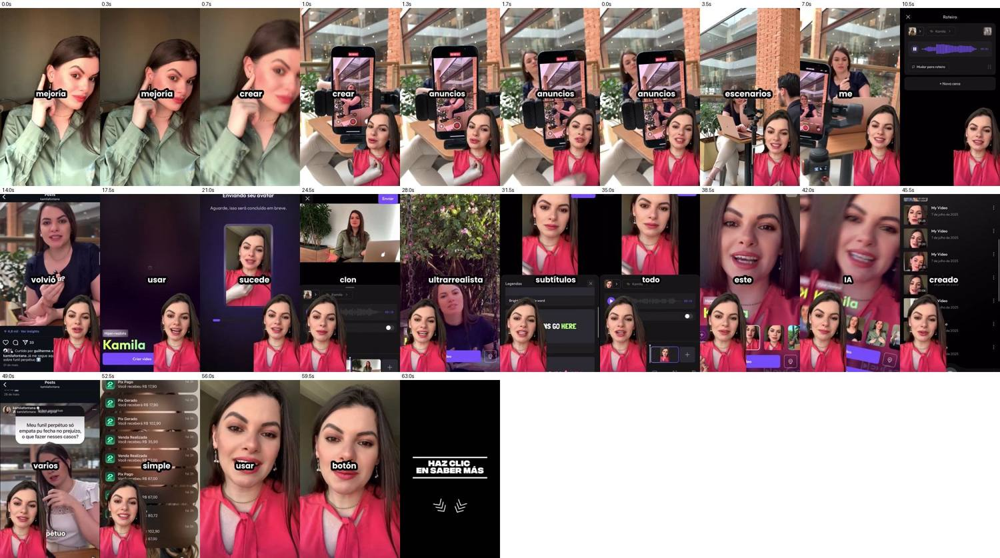
- **Abertura:** dedo na bochecha, close; depois o bastidor (celular no tripé gravando).
- **Gancho/dor:** "Para criar anúncios, roteiros, gravações, edições, cenários... era uma dor de cabeça total." **Virada:** "Até que comecei a usar esta IA."
- **Prova:** o app clonando, a lista de vídeos criados, notificações de Pix (só reais), metaprova.
- **Fecho:** cartão preto "CLIQUE EM SAIBA MAIS".
- **Por que funciona:** mostra o "antes" (o trabalho de gravar) em vez de só falar dele. 67 s: acima do máximo de 1 minuto.

### Criativo 11 · Demonstração com número · formato E · 53 s · 144 palavras
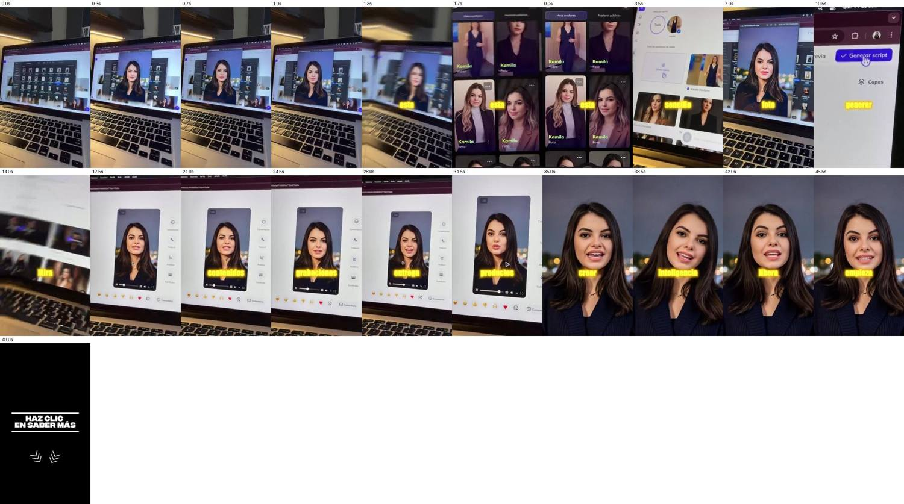
- **Abertura:** a tela do notebook filmada com o celular, com a avatar já aparecendo.
- **Gancho:** "Com só uma foto, essa IA gera vídeos em menos de cinco minutos."
- **Solução:** "É muito simples: adiciona um visual, escolhe a foto, clica em enviar... Em menos de 2 minutos o vídeo está pronto."
- **Prova:** o resultado tocando na tela, depois a avatar falando em tela cheia.
- **Por que funciona:** o gancho é a promessa com número e a prova chega em 15 s. Nenhuma cena com a pessoa real até o fim.

---

## 6. Como usar ao escrever os takes

- **Campo "quebra" do take 1:** escolha uma abertura da seção 2 que dê para gravar com o que vocês têm (objeto do nicho, gesto, entrar andando, faixa de público no topo).
- **Coluna "Na edição":** diga o formato da seção 1 (padrão: A, pessoa recortada no canto sobre as telas do produto), o estilo de legenda da seção 3 e o cartão final.
- **Antes de gravar:** liste as telas e exemplos do produto que vão de fundo (seção 4: a prova é a demonstração).
- **Edição:** passe para a `/editar-criativo` o formato, o estilo de legenda e as telas.

## 7. Decisões do Paulo sobre o que ela usa (04/11/2026)

- **Promessa de renda: pode usar**, como ela usa ("vende todos os dias", "vender muito mais", valor por mês), quando o número for real (resultado da especialista ou do cliente). Cuidado prático: o Meta costuma reprovar anúncio com promessa de ganho; ter sempre uma versão do mesmo vídeo sem a frase de renda para trocar se for reprovado.
- **"Antes que este vídeo saia do ar": pode usar.** É verdade: o anúncio pode ser pausado a qualquer momento. Escassez de oferta ("só por um momento") também, quando for o caso.
- **Resultados, relatos e notificações: usar os nossos, reais**, do mesmo jeito que ela usa (notificação de venda, Pix, prints de mensagens, insights, relato da especialista). Pedir esse material antes de escrever o roteiro.
- **Metaprova** ("este vídeo foi feito com IA"): só quando o produto é exatamente isso, para não confundir (erro já cometido no Anúncio Pronto).
- **Tempo:** 35 s a 1 minuto.
- **Gancho:** sem "curso", "aprenda", "método".
