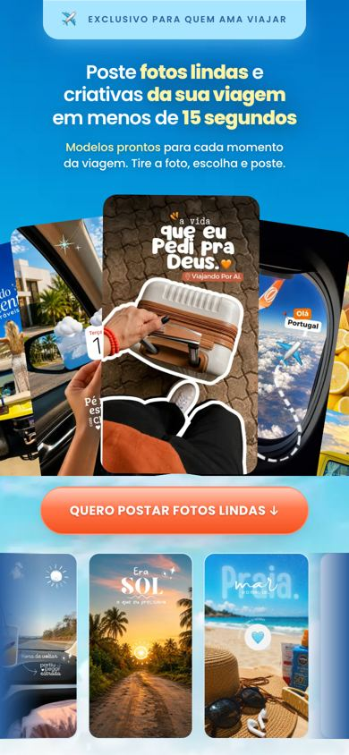
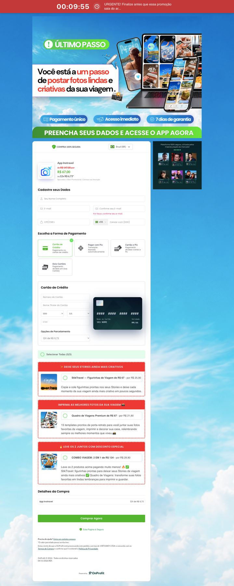
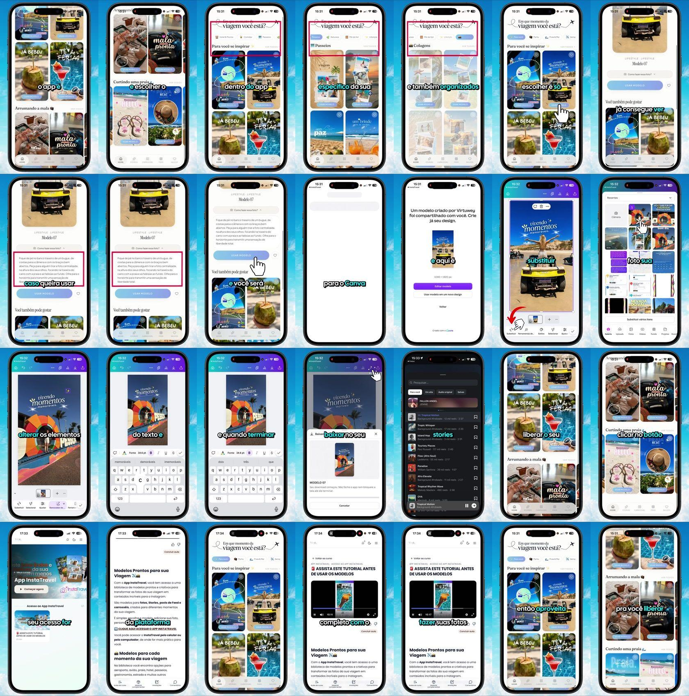

# Playbook da página de vendas low ticket

**Versão 1.1 · 04/11/2026.** Playbook da **metodologia** de página low ticket da Kamila, com todas as páginas dela como referência validada: Instravel (a mais nova, usada como exemplo principal por ser a mais bem acabada), 50 Viral Fit, 50 Carrossel Fit, App Stories Bíblicos e Ativa FIT. **Nenhuma está certa ou errada: onde elas diferem, é uma decisão por oferta** (seção 10).

Este playbook separa quatro coisas que andam juntas mas são diferentes: **a oferta** (o que se vende e por quanto), **a copy** (o que se escreve), **a prova** (o que faz acreditar) e **o design** (como se mostra). Para cada seção: o que tem, por que existe e como adaptar para outra oferta.

- Referência crua (texto inteiro, transcrição do vídeo, capturas, imagens): `.claude/skills/low-ticket/fontes/4-conhecimento/cursos-e-sistemas/Low Ticket Kamilla/Página de Vendas/referencia-instravel/`
- Página no ar: https://instravel.kamilafontana.com/
- Versão visual deste playbook: `PLAYBOOK-LOW-TICKET.html` (mesma pasta)
- Irmãos: `playbook-checkout-lt.md` (banner, order bumps, por que bump não é bônus) e `prompts-imagens-lt.md` (prompt de cada imagem)
- Skills que usam este playbook: `lt-oferta`, `lt-copy-pagina`, `lt-pagina`, `lt-video-passos`

---

## 1. A página em uma tela

A página inteira é uma descida só: **mostra o produto, prova, mostra de novo por dentro, mostra usando, dá mais, pede.** Ninguém precisa ler muito para entender o que está comprando: na primeira tela já aparecem 10 modelos do produto.

| # | Seção | Ponto da 13S | Função em uma frase | Botão |
|---|---|---|---|---|
| 1 | Topo: faixa + headline + sub | 1 Impacto + promessa | Diz para quem é e qual resultado, em 3 linhas | não |
| 2 | Vitrine: carrossel 3D de modelos + faixa rolante | 1 Impacto + 4 Entregáveis | Mostra o produto antes de qualquer explicação | QUERO POSTAR FOTOS LINDAS ↓ (5 s travado) |
| 3 | Depoimentos: nota + Stories de clientes + comentários | 2 Prova social | "Gente como eu já usa e ficou bonito" | flutuante (5 s) |
| 4 | Tudo em um só app: 8 categorias em vídeo | 4 Entregáveis | Volume (+100) e "tem para todo momento" | não |
| 5 | Como funciona: vídeo de tela + 4 ícones | 3 Passo a passo | Prova que é fácil, mostrando o uso real | QUERO ACESSAR O APP AGORA ✈️ ↓ |
| 6 | Bônus: 3 cartões | 5 Bônus | Tira as 3 últimas objeções de uso | flutuante (5 s) |
| 7 | Transição: 1 frase em faixa escura | 6 Resultado imaginado | Faz a pessoa se ver com o resultado antes do preço | não |
| 8 | Oferta: parabéns + cartão com preço | 7 Ancoragem + 8 Oferta | Preço pequeno, ação única | QUERO POSTAR FOTOS LINDAS ✈️ (checkout) |
| 9 | Garantia | 9 Garantia | Tira o risco | não |
| 10 | Autoridade: "Oie, eu sou a Kamila!" | 10 Autoridade | Quem fez e por que, em tom de amiga | não |
| 11 | Perguntas frequentes | 11 FAQ | Responde o que ainda trava | não |
| 12 | Rodapé | 13 Rodapé | Dados legais | não |

Nesta oferta ela escolheu: sem WhatsApp, âncora única em vez de "Recapitulando", frase de transição em vez de "Imagine...", garantia sem "Se apenas 1 X gerar 1 Y". São decisões desta oferta (seção 10), não regras.



---

## 2. A oferta (metodologia, não só esta página)

### 2.1 Promessa: os 4 pilares da Kamila, mapeados

> **Poste fotos lindas e criativas da sua viagem em menos de 15 segundos.**
> Modelos prontos para cada momento da viagem. Tire a foto, escolha e poste.

| Pilar | Onde está | Observação |
|---|---|---|
| Facilidade | "Poste", "Tire a foto, escolha e poste" | O verbo da headline já é o resultado (postar), não o acesso ("acesse", "baixe") |
| Especificidade | "em menos de 15 segundos" | Prazo na headline. O número de volume (+100 modelos) foi para a seção 4 |
| Produto de consumo rápido | "Modelos prontos" (na sub) | O produto fica fora da headline. A headline é só resultado |
| Desejo | "fotos lindas e criativas da sua viagem" | Desejo de identidade (ser vista bonita, registrar a viagem), não de dinheiro |
| Baixo esforço | "15 segundos", "tire, escolha e poste" | Implícito, sem a palavra "sem" |

**A evolução em relação às páginas antigas:**

| | 50 Viral Fit (antiga) | Instravel (nova) |
|---|---|---|
| Faixa | 🔥 EXCLUSIVO PARA NUTRICIONISTAS E PERSONAL TRAINERS | ✈️ EXCLUSIVO PARA QUEM AMA VIAJAR |
| Headline | Acesse 50 modelos prontos de Reels virais para ganhar seguidores e vender mais consultorias online (17 palavras) | Poste fotos lindas e criativas da sua viagem em menos de 15 segundos (12 palavras) |
| Verbo | de acesso ("Acesse") | de resultado ("Poste") |
| Produto | na headline | na sub |
| Especificidade | volume (50) | tempo (15 s) |
| Sub | Reels 100% editáveis com legendas prontas. É só baixar e postar. | Modelos prontos para cada momento da viagem. Tire a foto, escolha e poste. |

**Regra que sai daqui (já está na `lt-copy-pagina` e agora fica mais clara):** headline = verbo do resultado + o resultado desejado + tempo. O produto e o "como" vão para a subheadline, que termina nos 3 verbos do uso.

Fórmula: **[Verbo do resultado] [resultado desejado, com o objeto do avatar] em [tempo curto].** Sub: **[Produto pronto] para [cada situação do avatar]. [Verbo 1], [verbo 2] e [verbo 3].**

Exemplos de adaptação (só para mostrar a fórmula, não são ofertas aprovadas):
- Personal: "Poste Reels que trazem alunos em menos de 5 minutos por dia" / "Roteiros prontos para cada objetivo do aluno. Escolha, grave e poste."
- Confeitaria: "Venda bolos no WhatsApp com fotos de vitrine em 10 minutos" / "Modelos prontos para cada tipo de bolo. Fotografe, escolha e envie."

### 2.2 A faixa do topo nomeia uma identidade, não uma profissão

"Quem ama viajar" é como a pessoa se descreve. Ela se reconhece antes de ler a promessa. Nas páginas antigas era a profissão ("nutricionistas e personal trainers"). Para nicho de consumo, use a identidade ("quem ama X", "mães que Y"). Para nicho profissional, a profissão continua funcionando.

### 2.3 Produto

- App (web app instalável) com **+100 modelos** de Stories, posts e carrosséis, abertos no **Canva** (ferramenta que a pessoa já conhece: tira o medo de "não sei editar").
- Organizado por **momento da viagem** (8 categorias), não por tipo de arquivo. A pessoa pensa "estou no aeroporto", não "preciso de um story". **Organizar o produto pelos momentos da vida do avatar** é a ideia que mais vale copiar.
- Acesso por **1 ano** (dito só no FAQ). Pagamento único.

### 2.4 Os 3 bônus seguem a jornada de uso

Cada bônus responde uma pergunta que a pessoa faz em um momento diferente do uso:

| Bônus | Pergunta que ele responde | Momento | Por que este formato |
|---|---|---|---|
| 1 · Inspirações de Fotos | "E se eu não souber que foto tirar?" | **Antes** (na hora de fotografar) | É a objeção mais forte do avatar: o modelo é lindo, mas a foto dela é feia. Vem junto de cada modelo, então também aumenta o valor percebido de cada um |
| 2 · Posts para o Feed | "E se eu quiser postar no feed, não só no story?" | **Depois** (outro formato) | Amplia o uso do mesmo produto para outro lugar do Instagram. Mais valor sem mudar a promessa |
| 3 · Tutorial Passo a Passo | "E se eu não souber mexer?" | **Durante** (usar o app e o Canva) | Tira o medo técnico. O vídeo de "Como funciona" termina citando este bônus |

A pergunta do Bônus 1 aparece de novo no FAQ, com a mesma resposta. **Bônus e FAQ conversam: a objeção mais forte aparece duas vezes.**

Regra para adaptar: liste as 3 perguntas que travam o uso do produto (antes, durante, depois) e faça cada bônus responder uma. Bônus de consumo rápido, com nome concreto (nada de "Aula secreta" ou "Super bônus imensurável", que estava no 50 Carrossel Fit e saiu).

### 2.5 Preço e ancoragem

- **R$ 67 à vista ou 12x R$ 6,73.** O destaque é a parcela (parece "menos de 7 reais").
- Âncora: **"De R$ 147"**, 54% OFF, "Você economiza R$80". Uma âncora só, plausível (2,2x o preço).
- Nas antigas a âncora era R$ 297 com 84% OFF e lista "Recapitulando" com preço de cada item. A nova cortou a lista: menos leitura, decisão mais rápida, número mais crível.
- R$ 67 é o preço "depois de validar" da tabela da Kamila (`lt-oferta`: validação R$ 37, depois R$ 67). O Instravel já está na fase de escala.
- Order bumps e combo ficam no checkout (OnProfit), não na página. Ver 2.7.

### 2.6 Garantia

7 dias, texto no tom do produto ("Teste o app por 7 dias, conheça todos os modelos e veja como é fácil..."). Saiu o "Se apenas 1 Reels gerar 1 paciente, o investimento já se paga": essa frase serve para nicho profissional (o produto dá dinheiro). Em nicho de consumo, a garantia fala de experimentar.

### 2.7 Checkout e order bumps (prints do Paulo, 04/11/2026)

Resumo. A análise completa (banner, ordem dos bumps, bônus x bump, como criar) está em `playbook-checkout-lt.md`.

O checkout continua a página: **mesmo céu de fundo**, mesmo mockup, mesma frase.



**Banner do topo:**
- Selo verde "ÚLTIMO PASSO".
- "Você está a um *passo* de *postar fotos lindas* e *criativas* da sua viagem." É a frase de transição da página, agora com o verbo da headline. A promessa aparece pela terceira vez, idêntica.
- Mockup (notebook + celulares) e 3 pílulas: Pagamento único · Acesso imediato · 7 dias de garantia.
- Barra verde: "PREENCHA SEUS DADOS E ACESSE O APP AGORA" (instrução, não venda).
- Faixa vermelha fixa no alto: cronômetro de 10 min + "URGENTE! Finalize antes que essa promoção saia do ar..." (pode usar; regra do cronômetro por visitante na seção 5).
- Ao lado do formulário: "Plataforma 100% segura, utilizada pelos maiores players do mercado" com fotos (prova da plataforma, não do produto).
- Produto no resumo: "App Instravel, de R$ 147 por R$ 67, ou 12x R$ 6,73".

**Order bumps (2 produtos + 1 combo, não 3):**

| Cabeçalho vermelho (benefício) | Produto | Preço | Momento da jornada |
|---|---|---|---|
| ✨ DEIXE SEUS STORIES AINDA MAIS CRIATIVOS | StikTravel: Figurinhas de Viagem | de R$ 67 por **R$ 25,90** | Durante: enfeita o mesmo Story |
| IMPRIMA AS MELHORES FOTOS DA SUA VIAGEM 📸 | Quadro de Viagens Premium (15 templates de porta-retrato para imprimir) | de R$ 67 por **R$ 21,90** | Depois: leva a viagem para fora do Instagram, para a casa |
| 🔥 LEVE OS 2 JUNTOS COM DESCONTO ESPECIAL | COMBO VIAGEM: 2 em 1 | de R$ 134 por **R$ 29,90** | Os dois por pouco mais que um |

O que ensinar daqui:
- **O cabeçalho do bump é o benefício, não o nome do produto.** O nome vem embaixo, em negrito, com "de/por".
- Cada bump continua a mesma promessa ("fotos lindas da viagem") em outro momento: no Story (figurinhas) e na parede (quadro). Nada de assunto novo.
- O combo é o bump mais esperto: R$ 29,90 pelos dois, contra R$ 47,80 separados. Quem ia pegar um pega os dois.
- Há um "Selecionar todas (0/3)" acima dos bumps.
- Diferença da tabela da Kamila (`lt-oferta`: 3 bumps de R$ 15,90 a R$ 17,90 e combo 3 em 1 a R$ 35,90 para produto de R$ 67): aqui são 2 bumps mais caros (R$ 21,90 e R$ 25,90) e combo 2 em 1 a R$ 29,90. Os dois modelos são válidos; o de 2 + combo é mais simples de produzir.
- Banner do checkout: a skill `lt-banner-checkout` faz este formato.

---

## 3. A copy, seção por seção

Tom geral: amiga que viaja falando com outra. Frases curtas, emoji ✈️ em quase todo título (o emoji do nicho vira assinatura), "Oie", "perrengues 😂". Zero jargão. Nenhuma palavra proibida (aprenda, descubra, método, estratégia).

### 3.1 Topo
- Faixa: emoji do nicho + "EXCLUSIVO PARA QUEM [identidade]".
- Headline e sub: ver 2.1. Destaques em amarelo-limão nas 3 partes que vendem: o resultado ("fotos lindas"), o objeto ("da sua viagem") e o tempo ("15 segundos").
- Botão: "QUERO POSTAR FOTOS LINDAS ↓". **O botão repete o desejo da headline**, na voz da pessoa ("QUERO" + resultado). Nunca "comprar" ou "saiba mais".

### 3.2 Vitrine
Sem texto. O produto fala sozinho. É a "prova de produto" antes da prova social.

### 3.3 Depoimentos
- "5,0 / +X avaliações / ⭐⭐⭐⭐⭐ / O app queridinho de quem *ama viajar* ✈️" (regras na seção 5).
- H2: "Veja as fotos de *quem já está usando!*" O título fala de **fotos** (o resultado visível), não de opiniões.
- Logo abaixo, carrossel 3D **simétrico** com os prints de Stories das clientes: o do meio de frente e maior, os outros saindo **iguais para a esquerda e para a direita**, girados e menores, passando sozinhos e com setas e bolinhas. Mesmo comportamento do carrossel da vitrine.

### 3.4 Tudo em um só app
- Etiqueta "TUDO EM UM SÓ APP ✈️" (resolve "vou precisar de vários apps?").
- H2 com o número de volume: "*+100 modelos de fotos* lindas, criativos e personalizáveis 📷".
- Fecho com a dor, não com a solução: "*Nunca mais perca tempo da sua viagem* pensando no que postar ou criando post do zero. 😩". A dor aparece aqui pela primeira vez, depois que a pessoa já viu o produto e a prova. É a única frase de dor da página toda além da autoridade.

### 3.5 Como funciona
- H2 repete a promessa: "Veja como é simples postar uma foto linda em *menos de 15 segundos*".
- "Veja como é fácil usar o app 👇" aponta para o vídeo.
- 4 passos de 3 palavras: Acesse o app → Escolha o modelo → Coloque sua foto → Baixe e poste. (Nas antigas eram 3 passos. Aqui são 4 porque o "acesse o app" é um passo real. Use o número de passos que o uso tem, curto.)
- Botão: "QUERO ACESSAR O APP AGORA ✈️".

### 3.6 Bônus
- Etiqueta "E NÃO PARA POR AÍ..." (a frase fixa da Kamila virou etiqueta).
- H2: "Além do app, você ainda recebe *3 bônus exclusivos* 🎁".
- Cada bônus: nome concreto + 1 a 2 frases do que é e para que serve.

### 3.7 Transição
"Você está a um passo de ter *fotos lindas e criativas* para cada momento da sua próxima viagem. ✈️"
É o "Imagine..." resumido: uma frase que coloca a pessoa na próxima viagem com o resultado. Faixa escura para marcar "agora vem o preço".

### 3.8 Oferta
Ordem dos elementos: parabéns com o desconto → urgência → produto (mockup + logo + "+3 bônus") → preço riscado → parcela gigante → à vista → economia → botão → bandeiras → checks → alerta.
- "🎉 Parabéns!!! Você ganhou 54% OFF": a pessoa "ganhou" algo antes de ver o preço (recompensa, não cobrança).
- Botão do checkout tem o mesmo texto do botão do topo: "QUERO POSTAR FOTOS LINDAS ✈️". O começo e o fim da página falam a mesma coisa.

### 3.9 Garantia
Título curto em maiúsculas + 1 parágrafo no tom do produto, terminando com o emoji do nicho.

### 3.10 Autoridade
Estrutura em 5 parágrafos:
1. Quem sou, ligada ao nicho ("Sou apaixonada por viagens... estou conhecendo o Nordeste").
2. O que percebi (a dor, em negrito): "a última coisa que a gente quer é perder tempo pensando no que postar... enquanto poderia estar aproveitando a viagem".
3. Como surgiu ("entre viagens, fotos e muitos perrengues 😂").
4. O que é (em negrito, a lista do produto).
5. Para quem é + certeza ("Tenho certeza de que você vai amar ter ele nas suas próximas viagens").
Não fala de anos de mercado nem de números. A autoridade é **vivência** (ela é o avatar), não currículo. Em nicho profissional, a versão antiga ("Não é teoria", anos de experiência) continua válida.

### 3.11 FAQ (8 perguntas, cada uma mata uma objeção)
| Pergunta | Objeção |
|---|---|
| Como recebo acesso ao app? | "Vou receber mesmo? Como?" |
| Os modelos já vêm prontos? | "Vou ter trabalho?" |
| E se eu não souber que foto tirar? | A mais forte (repete o Bônus 1) |
| Posso acessar pelo celular? | "Preciso de computador?" |
| Funciona em Android e iOS? (+ "não ocupa espaço... você vai precisar dele para as fotos 😂") | Técnica, respondida com humor e com o nicho |
| Tem mensalidade? | Medo de cobrança recorrente |
| Por quanto tempo terei acesso? | 1 ano (a única informação "ruim" fica aqui, dita de forma neutra) |
| O produto tem garantia? | Risco |

### 3.12 Rodapé
Logo, ©, empresa, CNPJ, links, aviso legal do Facebook (o único texto fixo de verdade).

---

## 4. Os argumentos de prova (o que faz acreditar)

A página prova a mesma coisa 6 vezes, de 6 jeitos diferentes. Nenhum deles é "confie em mim":

| # | Argumento | Onde | O que prova |
|---|---|---|---|
| 1 | Produto na tela | Vitrine (10 modelos em 3D + 10 na faixa) | "É bonito" (a promessa "fotos lindas" se prova sozinha) |
| 2 | Uso real | Stories de clientes postados com o app | "Fica bonito com a foto de gente comum" |
| 3 | Volume organizado | 8 vídeos de categoria | "Tem para todo momento" (+100) |
| 4 | Demonstração | Vídeo de tela de 70 s | "É fácil e leva segundos" (prova o "15 segundos") |
| 5 | Vivência da criadora | Autoridade | "Quem fez passou pelo mesmo problema" |
| 6 | Risco zero | Garantia | "Se não gostar, não perco nada" |

Mais a nota e os comentários (regras na seção 5).

**Regra para adaptar:** antes de escrever, liste como provar a promessa em cada um desses 6 jeitos. Em produto digital, os argumentos 1, 3 e 4 sempre dá para fazer, mesmo sem nenhum cliente. Lembrando a regra da Vissia: **a página mostra, mas não entrega o produto** (em PDF e prompts, teaser borrado).

---

## 5. Depoimentos: por que cada um existe

Os 15 comentários não são aleatórios. Cada um responde uma objeção ou abre um público. É uma **matriz de objeções em forma de depoimento**:

| Quem | Objeção ou ideia que o texto carrega |
|---|---|
| Juliana | "Não sei tirar foto, sai tudo torto" → todo mundo perguntou quem editou |
| Camila | "Não tenho viagem marcada" → serve para passeio de fim de semana |
| Rafaela | Prova da promessa com número: 40 minutos → 15 segundos |
| Bruna | Frequência e status: postou todo dia, "cara profissional" |
| Patrícia | Preço / valor: "melhor investimento do ano", usa até fora de viagem |
| Larissa | Variedade: praia, cidade, hotel, comidinha |
| Thiago | Abre o público masculino: "achei que era só pra mulherada" |
| Vanessa | "Não sei montar story" → é só substituir as fotos |
| Aline | "Vai ficar igual ao de todo mundo" → dá para deixar com a minha cara |
| Fernanda | Compra por impulso sem arrependimento (valida o low ticket) |
| Marina | Vergonha das próprias fotos → ganhou confiança |
| Débora | Ocasião especial (lua de mel) + rapidez no café da manhã |
| Gustavo | "Não tenho paciência pra editar" + público de viagem a trabalho |
| Isabela | Indicação de amiga + resultado social: post com mais curtidas do ano |
| Sophia | Ainda não viajou → usou com fotos antigas |

Também variam: destinos brasileiros reconhecíveis (Porto de Galinhas, Gramado, Maceió, Maragogi, Búzios) e um internacional (Chile), datas espaçadas ("3 dias" a "2 meses"), um ou dois homens.

**Como usar isso na Vissia (do jeito certo):**
1. **Os depoimentos vêm de retornos reais** (print ou texto copiado de Google, direct, WhatsApp, comentário). Não se escreve depoimento do zero.
2. Use a matriz como **roteiro para coletar**: depois das primeiras vendas, pergunte aos compradores as perguntas que geram esses depoimentos ("Você achou que ia conseguir? O que mudou?", "Usou em que ocasião?", "O que te fez comprar?"). Depois escolha um depoimento real por objeção.
3. O formato visual (cartão com inicial colorida, nome, estrelas, tempo) é o padrão para os textos. Prints vão no carrossel.

### Regras da prova social (decididas pelo Paulo, 04/11/2026)

- **Nota "5,0 · +X avaliações": pode usar.** O número vem de avaliações reais da marca ou da especialista como um todo (outros produtos, perfil, Google, alunos), não precisa ser só deste produto. Não escrever que é avaliação "deste produto". O mesmo número em várias páginas da Kamila (+1.795) é coerente com isso.
- **Comentários em texto, sem foto, @ ou link: pode usar.** O texto vem de um retorno real (avaliação do Google, direct, WhatsApp, comentário, e-mail). O Paulo manda os textos e a página monta no formato de cartão (inicial colorida, nome, estrelas, tempo). Pode ajustar o tamanho e a ortografia, sem mudar o sentido. **O que não se faz é escrever um depoimento do zero.**
- **Prints de uso: usar sempre.** Stories, carrossel, página, Instagram, WhatsApp, qualquer print de quem usou. É a prova mais forte da página (no Instravel: o carrossel 3D com os Stories das clientes).
- **Material validado do mercado:** como o produto junta modelos que já funcionam (modelos de Canva usados por blogueiras, anúncios que já venderam no Anúncio Pronto), a prova pode falar do resultado desses modelos.
- **Cronômetro de 15 minutos por visitante: pode usar**, como "Oferta por tempo limitado / Válida somente até o tempo acabar". A oferta é daquela visita. **Quando zera, nada muda** (decisão do Paulo, 04/11/2026): o cronômetro para em 00:00:00 e preço, textos e botão ficam iguais. Não reinicia ao recarregar a página.

---

## 6. Design

### 6.1 O tema do nicho vira o design
Tudo vem de "viagem": fundo de céu no topo e na oferta, nuvens borradas como divisória entre seções, avião ✈️ em quase todo título, azul do céu e coral do pôr do sol. A pessoa sente o assunto antes de ler. **Para adaptar: escolha a imagem-mundo do nicho** (cozinha, academia, igreja, escritório) e faça dela o fundo do topo e da oferta, a divisória e o emoji.

### 6.2 Cores (papéis, não valores)
| Papel | Instravel | Uso |
|---|---|---|
| Fundo de impacto | Foto de céu (#2C5F9E por baixo) | Topo e oferta (abre e fecha a venda no mesmo cenário) |
| Fundo de leitura | Degradê branco → #F4FBFF → #EAF6FD | Todas as seções de conteúdo |
| Escuro de pausa | Azul-marinho #12294F | Faixa de transição e rodapé |
| Texto | Azul #2D609F (corpo), #12294F (títulos fortes) | Nunca preto puro |
| Destaque sobre foto | Amarelo-limão #FFF3A6 | Palavras-chave da headline |
| Destaque sobre claro | Coral #FF7043 (e degradê #FFB199 → #FF7043) | Palavras-chave dos títulos, etiquetas de bônus |
| Botão de avançar | Degradê coral #FF8A65 → #FF7043 → #F4511E | Topo e flutuantes |
| Botão do meio | Ciano #28C9E6 | Como funciona |
| Botão de compra | Verde #66BB6A → #4CAF50 → #43A047 | Só o do checkout |
| Urgência | Vermelho #DC2626 | Cabeçalho da oferta e alerta |
| Linhas e etiquetas | Azul-bebê #A8E6FF / #DCF1FB | Faixa do topo, bordas, pílulas |

**Cor por função do botão:** coral leva para baixo, verde leva para o pagamento. A pessoa aprende sem perceber que o verde é o "de verdade".

### 6.3 Tipografia
Uma fonte só: **Poppins** (400, 500, 600, 700, 800). Títulos com letras um pouco mais juntas (-0,02 a -0,035 em).

| Elemento | Celular (390 px) | Computador |
|---|---|---|
| Headline | 17 a 26 px (5,5 vw, fica ~21 px), peso 600, entrelinha 1,18 | 30 a 40 px, entrelinha 1,15 |
| Sub | 10,5 a 15 px (3,3 vw, ~13 px), peso 500 | 15 a 19 px |
| Título de seção (H2) | 20 a 29 px (5,8 vw, ~22 px), peso 700, entrelinha 1,22 | 28 a 40 px |
| Etiqueta (eyebrow) | 11 px, maiúsculas, espaço entre letras 0,18 em, peso 600 | igual |
| Texto corrido | 14 a 15 px, entrelinha relaxada | 15 a 16 px |
| Comentário | 13,5 px | igual |
| Título do bônus / descrição | 16 px / 12 px | 24 px / 14 px |
| Parcela da oferta | 48 px, peso 700 | 60 px |
| Pergunta do FAQ | 18 px | igual |
| Faixa do topo | 10 px, maiúsculas, espaço 0,14 em | 12 px |

Destaque de palavra: peso 800 + cor (limão sobre foto, coral sobre claro), sem itálico, com uma sombra leve.

### 6.4 Espaços e formas
- Seções: 48 px em cima e embaixo no celular, 64 px no computador. Laterais de 24 px (16 px na oferta).
- Largura máxima: 1280 px no geral; a oferta é uma coluna estreita (448 px) mesmo no computador.
- Cartões: canto de 24 px, borda azul-bebê fina, sombra azulada suave; sobem 3 px ao passar o mouse.
- Botões: pílula (totalmente redondos), 16 px de altura interna, maiúsculas, com um "reflexo de vidro" na metade de cima.
- Faixa do topo: aba presa no teto, cantos de baixo arredondados, 44 px de altura.

### 6.5 Celular primeiro, com quebras de linha escolhidas à mão
- A headline e os títulos têm **duas versões de quebra de linha**: uma para celular (3 linhas) e outra para computador (2 linhas). Cada linha é travada para não quebrar sozinha. Por isso nunca sobra uma palavra solta.
- No celular a sub é mais curta que no computador ("Tire a foto, escolha e poste." vs "É só tirar a foto, escolher o modelo, baixar e postar."). **Isso vai contra a nossa regra de "mesmo texto no celular e no computador".** Recomendação: manter a nossa regra para o texto e copiar só a ideia das quebras de linha por aparelho.
- No celular, o "Como funciona" inverte a ordem (título, vídeo, ícones, botão). No computador, vídeo à direita.
- Bônus no celular: imagem pequena (112 px) à esquerda e texto à direita, para caber 3 bônus em uma tela. No computador, 3 colunas.
- Categorias: 2 colunas no celular, 4 no computador.

### 6.6 Desempenho (por que ela abre rápido)
- Só o topo e a vitrine carregam de início; cada seção abaixo carrega quando a pessoa chega perto.
- Vídeos das categorias e do passo a passo só carregam a ~300 px de aparecer.
- Imagens em WebP com duas larguras (360 e 560 px); o fundo de céu tem versão de 828 px para celular.
- Clarity entra 2,5 s depois de a página abrir.

---

## 6A. Identidade visual: como a marca entra na página

A estrutura (seções, ordem, tamanhos, o que é grande e o que é pequeno) é da metodologia e não muda. **A identidade do especialista entra nos lugares certos dessa estrutura.** Cada cor, peso e tamanho tem uma função; trocar a marca é trocar quem ocupa cada função, não a função.

### 6A.1 Hierarquia de texto (o que é grosso, fino, grande, pequeno)

| Nível | Exemplo no Instravel | Tamanho (celular / computador) | Peso | Cor | Por quê |
|---|---|---|---|---|---|
| Headline | Poste fotos lindas e criativas... | ~21 / 30-40 px | 600, destaques 800 | Branco sobre foto, destaques limão #FFF3A6 | O peso 800 só nos destaques faz o olho ler primeiro "fotos lindas · da sua viagem · 15 segundos" |
| Sub | Modelos prontos para cada momento... | ~13 / 15-19 px | 500 | Branco, "Modelos prontos" em limão | Menor e mais leve: explica, não compete |
| Título de venda (H2) | +100 modelos..., Veja as fotos de..., Além do app... | ~22 / 28-40 px | 700, destaque 800 | Azul #2D609F, destaque coral #FF7043 | Seções que vendem: grosso |
| Título de conversa | Oie, eu sou a Kamila! · GARANTIA DE 7 DIAS · frase de transição | 30 / 36-48 px | **400 (fino)**, só o nome ou o número em 800 | Azul ou branco; nome em coral | Fino = tom de pessoa falando. O contraste fino + grosso na mesma frase chama o olho para o nome ou o número |
| Etiqueta (eyebrow) | COMO FUNCIONA · E NÃO PARA POR AÍ... | 11 px | 600, caixa alta, letras espaçadas | Azul em pílula azul-clara | Diz o nome da seção antes do título: dá para escanear a página pelas etiquetas |
| Etiqueta de bônus | BÔNUS 1 | 10-11 px | 600 caixa alta | Branco em pílula coral com sombra | Mais quente que a etiqueta comum: bônus é presente |
| Texto corrido | Autoridade, bônus, garantia | 14-15 px (bônus 12) | 400 | Azul acinzentado | Só a frase-chave em negrito e na cor do título |
| Nota | 5,0 | 40-66 px | 800 | Azul escuro | Um número gigante vale mais que um parágrafo |
| Cartão de comentário | Nome / tempo / texto | 14 / 11 / 13,5 px | 700 / 400 / 400 | Preto / cinza / cinza escuro | Parece comentário real de rede social |

**Regras de destaque:**
- Em cada título, destacar 2 ou 3 trechos: o **resultado**, o **público ou objeto** e o **número ou tempo**. Nunca a frase inteira.
- Destaque = peso 800 + cor. Sem itálico, sem sublinhado.
- A cor do destaque depende do fundo: **sobre foto** (escuro) usa a cor clara e quente (limão); **sobre fundo claro** usa a cor quente forte (coral); **na seção de uso** (Como funciona) usa a cor do botão daquela seção (ciano).
- Emoji do nicho fecha os títulos (✈️ 📷 🎁 🤍). Um por título.

### 6A.2 Cores com significado (o que é fixo e o que é da marca)

| Função | Instravel | Fixa ou da marca? | Onde aparece |
|---|---|---|---|
| Fundo de impacto (mundo do nicho) | Foto de céu | **Da marca** (imagem do universo do nicho) | Topo, oferta, checkout |
| Texto e títulos | Azul #2D609F / marinho #12294F | **Da marca** (a cor escura dela) | Tudo |
| Destaque sobre claro e botão de avançar | Coral #FF7043 | **Da marca** (a cor quente/primária) | Títulos, etiquetas de bônus, botões que descem |
| Destaque sobre foto | Limão #FFF3A6 | **Da marca** (tom claro que contraste com o fundo) | Headline e sub |
| Cor de uso / meio | Ciano #28C9E6 | **Da marca** (secundária) | Como funciona: ícones, destaque, botão |
| Linhas, etiquetas, bordas | Azul-bebê #A8E6FF / #DCF1FB | **Da marca** (tom bem claro da secundária) | Faixa do topo, pílulas, bordas dos cartões |
| Fundo de leitura | Branco → #EAF6FD | **Da marca** (branco puxado para a cor dela) | Seções |
| Pausa escura | Marinho #12294F | **Da marca** (a mais escura) | Transição e rodapé |
| **Dinheiro e ganho** | Verde (#10B981, #4CAF50) | **Fixa** | Parabéns, "+3 bônus", parcela, economia, botão de compra |
| **Perda e urgência** | Vermelho (#DC2626) | **Fixa** | Cabeçalho do cronômetro, preço riscado, alerta |
| Checks | Laranja | Fixa (pode ser a quente da marca) | Pagamento único / Sem mensalidade |

A lógica: **a marca pinta a conversa; verde e vermelho pintam o dinheiro.** Verde = o que a pessoa ganha (desconto, bônus, preço, compra). Vermelho = o que ela perde (tempo acabando, preço cheio, sair da página). Isso não muda de marca para marca, porque é como o cérebro lê preço.

### 6A.3 Anatomia do preço

De cima para baixo, no cartão branco da oferta:

| Elemento | Tamanho | Cor | Função |
|---|---|---|---|
| 🎉 Parabéns!!! Você ganhou 54% OFF | 14 px, 600 | Branco em pílula verde (degradê) | Recompensa antes do preço |
| OFERTA POR TEMPO LIMITADO | 10 px, 600, caixa alta, espaçada | Branco em faixa vermelha | Urgência |
| 00:15:00 | 24-30 px, 600, números de largura fixa | Branco | Tempo correndo sem a largura mudar |
| Logo do produto | 40-56 px de altura | A da marca | O que está comprando |
| +3 bônus exclusivos | 14-16 px, 600 | Verde escuro | Ganho |
| De R$ 147,00 | 14 px, riscado | Vermelho | Perda (o preço que não vai pagar) |
| por apenas 12x de | 12 px | Cinza | Passagem, quase some |
| **R$ 6,73** | **48 / 60 px, 700** | **Verde** | O maior elemento do cartão, dançando |
| ou R$ 67,00 à vista | 14 px | Cinza | Informação honesta, sem destaque |
| Você economiza R$80 levando agora | 12 px, 600 | Verde, borda tracejada verde | Ganho, em forma de cupom |
| QUERO POSTAR FOTOS LINDAS ✈️ | 16-18 px, 700 | Branco em verde, largura toda | A única ação |
| Checks e alerta | 13 px | Cinza com check laranja / vermelho em caixa vermelha clara | Tira o medo / lembra a perda |

**Regra:** a parcela é sempre o maior número da página depois da headline. O à vista aparece, mas pequeno. A âncora é pequena e riscada.

### 6A.4 Botões

| Botão | Cor | Texto | Forma |
|---|---|---|---|
| Avançar (topo, flutuantes) | Degradê da cor quente da marca (#FF8A65 → #FF7043 → #F4511E) | 14-16 px, 700, caixa alta, sombra no texto | Pílula, reflexo de vidro na metade de cima, sobe e desce |
| Meio (Como funciona) | Secundária da marca (ciano) | 13-16 px, 700, caixa alta | Igual |
| Compra | **Verde** (#66BB6A → #4CAF50 → #43A047) | 16-18 px, 700 | Pílula de largura total, halo verde pulsando |
| Flutuante | Cor quente da marca | Ícone ⌄ ou "5s" | Círculo 56 px no canto inferior direito |

### 6A.5 Bônus, cartões e fundos

- Cartão: branco, canto 24 px, borda fina na cor clara da marca, sombra puxada para a cor escura da marca.
- Bônus: etiqueta quente (BÔNUS N) + título 16/24 px peso 800 + descrição 12/14 px + imagem do bônus **sobre o fundo do mundo do nicho** (os três bônus têm o mesmo céu atrás: parecem da mesma família).
- Divisória entre seções: a textura do nicho (nuvens borradas no Instravel). Em outro nicho: farinha, folhas, luz, papel.
- Fundo de leitura sempre claro e quase branco, puxado para a cor da marca. A foto forte só no topo, na oferta e no checkout.

### 6A.6 Processo: encaixar a identidade de qualquer especialista

1. **Pegue a identidade aprovada** (`/identidade` ou o Playbook Visual do cliente). Se não existir, rode `/identidade` antes. Referência (Instravel) é estrutura, não identidade.
2. **Preencha os 10 papéis** da tabela 6A.2 com as cores da marca. Se faltar uma cor, derive da paleta: tom claro da secundária para linhas, tom escuríssimo da primária para pausa e texto.
3. **Escolha a imagem-mundo do nicho** (fundo do topo, da oferta, do checkout e dos bônus) e a textura da divisória.
4. **Fonte:** uma família sem serifa com pesos de 400 a 800 (Poppins, Plus Jakarta Sans, Montserrat, DM Sans). Se a marca usa uma fonte com serifa, ela entra só no nome da especialista ou na assinatura; o resto segue a sem serifa, para o contraste de peso funcionar.
5. **Mantenha fixos:** a escala de tamanhos (6A.1), o verde do dinheiro e da compra, o vermelho da urgência, a regra dos 2 ou 3 destaques por título.
6. **Escolha o emoji assinatura** do nicho (um só, repetido nos títulos).
7. **Confira contraste:** destaque sobre foto legível em 390 px; texto nunca preto puro; verde da parcela legível no branco.
8. **Registre no `pagina.json`** (campos do gerador `lt-pagina`): `primaria` = cor quente (botões e destaques), `destaque` = destaque sobre foto, `acento` = secundária (meio, etiquetas de bônus quando quiser outra cor), `escura` = texto e pausa, `fundo` = fundo de leitura, `sucesso` = verde (fixo), `alerta` = vermelho (fixo), `laranja` = checks.

Exemplo de troca (só para mostrar o encaixe):

| Papel | Instravel (viagem) | Confeitaria | Fé |
|---|---|---|---|
| Mundo do nicho | Céu | Bancada de mármore com luz da janela | Céu ao amanhecer com raios |
| Texto | Azul | Marrom chocolate | Azul-marinho |
| Quente (botões, destaques) | Coral | Rosa framboesa | Dourado |
| Destaque sobre foto | Limão | Creme | Branco quente |
| Secundária | Ciano | Verde-menta | Azul-céu |
| Verde / vermelho | Fixos | Fixos | Fixos |

## 6B. Velocidade: meta 95 e abrir em até 2 segundos

**Regra (Paulo, 04/11/2026):** toda página low ticket passa no **PageSpeed Insights do Google com nota 95 ou mais no celular e no computador**, abre em **até 2 segundos** e **não perde qualidade de imagem**. Motivo: tráfego pago. Página lenta faz a pessoa fechar antes de carregar, o pixel não registra a visita e o connect rate (cliques no anúncio que viram visita) cai.

### 6B.1 As metas (medidas no PageSpeed, celular)
| Métrica | O que é | Meta |
|---|---|---|
| Nota de desempenho | Nota geral do Google | **95 ou mais** (celular e computador) |
| LCP | Quando aparece o maior elemento da primeira tela | **até 2,0 s** |
| FCP | Quando aparece a primeira coisa | até 1,2 s |
| TBT | Quanto tempo o celular fica travado rodando script | até 150 ms |
| CLS | Quanto a página "pula" enquanto carrega | até 0,05 |
| Peso da primeira tela | Tudo que carrega antes de rolar | até ~300 KB |

### 6B.2 Onde estamos (medição de 04/11/2026, Lighthouse local, mesmo motor do PageSpeed)
| Página | Celular | Computador | O que mais pesa |
|---|---|---|---|
| Instravel (Kamila) | 36 | 60 | Feita em React (Lovable): 12 s de script travando o celular, vídeos, player da Panda |
| Anúncio Pronto (nosso, no ar) | 35 a 62 | 95 | Script das animações da página + `site.js` do site (4 a 6 s), pixel do Facebook, imagens maiores que o necessário (~330 KB a mais) |
| Meu Roteiro que Vende (nosso gerador) | 78 | 92 | Script da página (5 s no celular), imagens sem tamanho de celular |

Conclusão: **a Kamila é referência de oferta, copy e design, não de técnica.** A nossa página é HTML puro (sem React), então já sai na frente. Para chegar a 95, o que falta é o gerador da `lt-pagina` aplicar as regras abaixo.

### 6B.3 Como chegar a 95 sem perder qualidade
1. **HTML puro, sem framework** (nada de React/Lovable). É o que o gerador já faz.
2. **Primeira tela leve:** só o que aparece antes de rolar carrega na hora. A imagem principal do topo vai com prioridade alta e nunca em "carregar depois"; todo o resto carrega quando a pessoa chega perto.
3. **Imagens:** WebP (ou AVIF) com qualidade 80 a 85 (visualmente igual ao original), em 2 ou 3 tamanhos (ex.: 360, 560 e 828 px de largura para celular, 1920 para o fundo no computador) e o navegador escolhe o certo. Sempre com largura e altura declaradas (a página não pula). Guardar o original em alta; nunca aumentar imagem pequena.
4. **Fonte:** uma família, 3 ou 4 pesos, arquivo da própria página (woff2), o peso da headline carregado primeiro, texto aparece já com a fonte do sistema e troca sem piscar.
5. **Script mínimo:** animações feitas em CSS (mexendo só em posição e transparência), pausadas fora da tela, sem contador rodando o tempo todo. Carrosséis e faixa rolante em CSS.
6. **Pixel e rastreio sem travar:** Meta Pixel, UTMify e Clarity carregam logo depois da página aparecer (evento de "carregou" ou primeira interação), nunca antes da headline. O PageView continua sendo registrado porque a página abre em menos de 2 s.
7. **Vídeos:** nunca carregam no início. Só a ~300 px de aparecer, com capa leve (WebP) no lugar; MP4 de até ~1,5 MB por vídeo de categoria (720 px); vídeo maior (Panda, YouTube) só com capa + play até a pessoa chegar perto.
8. **CSS dentro da página** (sem arquivo externo que segura a primeira tela).
9. **Hospedagem na Vercel** (servidor perto, compressão, cache longo das imagens).
10. **Medir antes de publicar** e depois de cada mudança: `python3 .claude/skills/low-ticket/skills/lt-pagina/scripts/medir_velocidade.py <url ou pasta>` (3 rodadas, vale a mediana). Com a chave do PageSpeed no `.env` (`PAGESPEED_API_KEY`, gratuita no Google Cloud) usa a medida oficial; sem chave usa o Lighthouse local (Mac lento: serve para comparar antes e depois). Também dá para medir à mão em pagespeed.web.dev.

## 6C. Réplica fiel: checklist (pontos do Paulo, 04/11/2026)

**Status:** página de teste do modelo v2 aprovada pelo Paulo em 04/11/2026 ("é realmente isso"). Velocidade: 98 no celular e 100 no computador.

Na primeira versão do modelo v2 eu encaixei as peças novas no visual antigo do gerador e o resultado ficou diferente da referência em quase tudo. Esta lista é o que o Paulo apontou, seção por seção. **Toda réplica passa por ela e pelo `comparar_referencia.py` antes de ser mostrada.**

**Geral**
- [ ] Mesma fonte (Poppins no Instravel), mesmos pesos e tamanhos em cada nível (seção 6A.1). Nada de "parecido".
- [ ] Quebras de linha iguais às da referência, com versão própria para celular e computador (headline em 3 linhas no celular, 2 no computador; sub em 2 linhas).
- [ ] Destaques com o mesmo efeito: limão com sombra na headline; degradê quente com brilho nos títulos ("3 bônus exclusivos", "+100 modelos", "Kamila!"); coral simples em "quem já está usando!".
- [ ] Etiquetas das seções em pílula azul-clara, caixa alta e letras espaçadas (não coral).
- [ ] Sem linhas ou bordas que a referência não tem: o topo esmaece em branco e a seção seguinte começa com a borda de nuvem.

**Topo e vitrine**
- [ ] Faixa em aba centralizada, azul-clara.
- [ ] Carrossel 3D sem sombra, borda ou fundo nos cartões (cantos limpos); pela largura toda; simétrico.
- [ ] Movimento em mola (os cartões deslizam juntos pela curva do leque, sem pulo); o cartão que dá a volta some na ponta, não atravessa a tela.
- [ ] **Computador:** cartões das pontas inteiros, sem corte reto embaixo, **sem aumentar o espaço** até o botão (passam por trás do botão e da faixa). **Celular:** cartões inteiros também (sem linha, sem esmaecer, sem sombra) e o botão fica 36 px abaixo do fim do carrossel (**aprovado pelo Paulo em 04/11/2026**) (Paulo, 04/11).
- [ ] Faixa de capas sempre passando e botão balançando. Não desligar animações quando o aparelho está com "Reduzir movimento" ligado (a referência não desliga; o Mac do Paulo usa essa opção).
- [ ] Botão do tamanho do texto (não largura total), com o espaço certo depois do carrossel. **Sem a contagem de 5 s** (Paulo, 04/11: tirar; o botão já nasce liberado).

**Depoimentos**
- [ ] "5,0" com os ramos dourados dos dois lados; avaliações, estrelas e a linha "queridinho".
- [ ] Prints em **pilha em profundidade** (cartões retos em fila, empurrados para trás com perspectiva), infinita **dos dois lados**, passando a cada 2 s, pausando com o mouse em cima e com arraste suave; setas e bolinhas embaixo. (No dela só um lado funciona: o nosso corrige.)
- [ ] Trilho de comentários passando sozinho.

**Tudo em um só app**
- [ ] Os 8 vídeos de categoria (todos), na grade de 2 colunas no celular e 4 no computador, com borda azul-clara e brilho.

**Como funciona**
- [ ] Etiqueta centralizada no alto; título grande (3 linhas no computador), na cor escura, destaque na cor secundária.
- [ ] Ícones de linha em caixas brancas grandes (56 px no celular, 80 px no computador) com número no canto, brilho atrás e seta entre eles.
- [ ] Botão secundário com o mesmo efeito (reflexo, sobe e desce); vídeo no cartão com borda e brilho, sem barra embaixo.

**Bônus**
- [ ] Título em 3 linhas no celular e 2 no computador, destaque com brilho.
- [ ] Cartões estreitos com espaço interno grande; etiqueta coral "BÔNUS N"; título 24 px; texto fino; imagem embaixo (computador) ou ao lado (celular).

**Oferta**
- [ ] Cartão estreito (448 px). Mockup à esquerda e, à direita, logo, "+3 bônus exclusivos" e "De R$" riscado.
- [ ] Parcela grande e dançando; à vista pequeno; cupom tracejado verde; botão verde de largura total pulsando.
- [ ] Imagem das bandeiras de pagamento (a do produto), checks com o separador "|".
- [ ] Alerta em caixa vermelho-clara com borda vermelha e ícone (não verde, não cheio).
- [ ] Quando o cronômetro zera, **nada muda** (seção 5).

**Garantia**
- [ ] Fundo claro (não escuro). Cartão branco com borda azul-clara e brilho.
- [ ] Selo do produto; título fino "GARANTIA DE 7 DIAS" (sem "Compra 100% Segura" e sem subtítulo laranja); texto no tamanho normal.

**Autoridade, FAQ e rodapé**
- [ ] Autoridade: título fino com o nome em destaque com brilho, cargo, 5 parágrafos e a foto redonda ao lado.
- [ ] FAQ: seção própria com etiqueta "AINDA TEM DÚVIDAS?", cartões brancos e seta que gira.
- [ ] Rodapé azul-marinho com a logo no alto, ©, empresa, links e aviso legal.

## 7. Animações (tudo que se mexe)

| Onde | O que acontece | Tempo |
|---|---|---|
| Todas as seções | Título e blocos sobem 20 px e aparecem, uma vez só | ~0,5 s; cartões em cascata de 0,05 a 0,15 s |
| Vitrine | Carrossel 3D em leque: o do meio de frente, os outros girados (8 a 12°) e menores; passa sozinho | a cada 1 s, com mola; dá para arrastar |
| Vitrine | Faixa de capas correndo para o lado, bordas esmaecidas | 40 s por volta, sem parar |
| Botão do topo | Travado com "5s, 4s..." e barra enchendo, depois libera | 5 s |
| Botões coral e ciano | Sobem 10 px e voltam, com sombra colorida; brilho passa por dentro no mouse | 2,2 s |
| Setinha dos botões | Desce e sobe | 1,2 s |
| Depoimentos | Carrossel 3D de Stories (mesmo do topo, com setas e bolinhas); trilho de comentários passando | comentários a cada 3,5 s, pausa no mouse |
| Botão flutuante | Aparece só enquanto a seção de depoimentos ou de bônus está na tela; conta 5 s e vira seta pulando | 2,2 s |
| Categorias | 8 vídeos mudos tocando em loop | contínuo |
| Como funciona | Ícones aparecem um por um, depois as setas; ícone sobe no mouse | 0,15 s entre eles |
| Oferta | Pílula "Parabéns" estoura (cresce e assenta) e fica brilhando; 26 confetes caem | 0,65 s; confete 1,8 s, some em 3,6 s |
| Oferta | Parcela "R$ 6,73" dança (cresce 12% e gira 2°) | 1,6 s, sem parar |
| Oferta | Botão verde pulsa com halo verde | 1,8 s |
| FAQ | Abre e fecha suave, uma de cada vez | 0,2 s |

**O botão travado por 5 segundos** (página dela) foi **tirado no nosso modelo** (Paulo, 04/11/2026). Era a novidade mais curiosa. Leitura provável: faz a pessoa ficar na vitrine (o produto passando) antes de descer, e o botão "liberado" parece uma recompensa. É hipótese: vale testar A/B antes de virar regra, porque também pode irritar quem já quer descer.

---

## 8. Botões (CTAs)

| # | Texto | Onde | Leva para | Cor |
|---|---|---|---|---|
| 1 | QUERO POSTAR FOTOS LINDAS ↓ | Abaixo da vitrine | Depoimentos | Coral (travado 5 s) |
| 2 | (seta flutuante) | Canto, durante os depoimentos | Categorias | Coral (5 s) |
| 3 | QUERO ACESSAR O APP AGORA ✈️ ↓ | Depois dos 4 passos | Bônus | Ciano |
| 4 | (seta flutuante) | Canto, durante os bônus | Oferta | Coral (5 s) |
| 5 | QUERO POSTAR FOTOS LINDAS ✈️ | Cartão da oferta | **Checkout** | Verde |

- Só **um** botão vai ao checkout. Todos os outros descem a página. Ninguém pula a prova.
- Texto sempre em 1ª pessoa, com "QUERO" + o resultado da headline. O primeiro e o último são iguais.
- Seta ↓ nos botões que descem; emoji do nicho no de compra.

---

## 9. O vídeo do passo a passo (roteiro para gravar)

Diferente do vídeo animado de 3 passos (`lt-video-passos`), aqui é uma **gravação de tela real do celular**, com a voz da criadora. Vertical (9:16), 70 s.



### 9.1 Estrutura (com os tempos do Instravel)
| Bloco | Tempo | O que fala | O que mostra |
|---|---|---|---|
| 1. Abertura de facilidade | 0 a 5 s | "E para usar o app é muito simples, é só entrar aqui e escolher o modelo." | Já dentro do app, rolando os modelos |
| 2. Organização | 5 a 12 s | "Você encontra modelos para cada momento... organizados por categoria." | Toques nas categorias (retângulo vermelho em volta) |
| 3. Escolha + diferencial | 12 a 21 s | "É só clicar no modelo e aqui você já vê uma inspiração de como fazer a foto." | Abre um modelo e mostra o Bônus 1 dentro do uso |
| 4. Personalizar | 21 a 40 s | "Clica em usar modelo e vai direto para o Canva... só substitui a foto... muda cor, texto..." | Canva: troca a foto, mexe no texto |
| 5. Resultado | 40 a 46 s | "Clica nessa setinha, baixa no celular e posta direto nos stories." | Baixando e abrindo o Instagram |
| 6. Fecho | 46 s | "Viu como é simples?" | Volta para o app |
| 7. CTA + o que acontece depois | 47 a 70 s | "Clica no botão aqui embaixo... recebe um e-mail com o link... e um tutorial completo (Bônus 3)... aproveita e clica no botão." | Área de membros, tutorial, de novo o app |

### 9.2 Regras de gravação e edição
- Gravação de tela do celular, sem rosto. Celular dentro de uma moldura de iPhone sobre o fundo do tema (água, céu).
- Narração em tom de conversa, frases começando com "E", "Depois é só", "E aqui é muito simples".
- Legenda palavra por palavra (2 a 3 palavras), letra branca grossa com contorno, palavra-chave em ciano.
- Retângulo vermelho em volta do que está sendo falado; ícone de mão clicando; seta vermelha apontando o botão.
- Cortes secos entre as telas, sem transição.
- O vídeo vende a facilidade **e** já responde "como eu recebo?" (e-mail, link, tutorial). O CTA aponta para "o botão aqui embaixo" (o botão da página logo abaixo do vídeo).

### 9.3 Roteiro em branco
```
[0-5 s]   E para usar o [produto] é muito simples: é só [ação 1] e escolher [o item].
[5-12 s]  Dentro do [produto] você encontra [itens] para cada [momento do avatar], organizados por [categoria].
[12-21 s] Depois de escolher, é só clicar e você já vê [diferencial / bônus 1].
[21-40 s] Aí é só [ação 2] e [ação 3]. Com poucos cliques você [personaliza].
[40-46 s] Quando terminar, é só [ação final] e [resultado].
[46 s]    Viu como é simples?
[47-70 s] Para liberar seu acesso, é só clicar no botão aqui embaixo. Você recebe [como chega] e ainda [bônus 3]. Então aproveita e clica no botão aqui embaixo.
```

### 9.4 Quando usar cada vídeo
- **Gravação de tela (este):** quando o produto já existe e tem interface (app, área de membros, Canva, planilha). Dá mais confiança: é o produto de verdade.
- **Animação de 3 passos (`lt-video-passos`):** quando o produto ainda não tem interface boa para mostrar, ou para anúncio.

---

## 10. As decisões por oferta (todas as páginas são validadas)

A 13S é a mesma em todas as páginas da Kamila. O que muda de uma para outra são **decisões**, tomadas conforme a oferta. Nenhuma opção é erro. Ao montar uma oferta nova, escolha uma opção em cada linha:

| Ponto da 13S | Opção A | Opção B | Quando escolher cada uma |
|---|---|---|---|
| 1 Impacto visual | Vitrine 3D do produto (Instravel) | Pessoa + celulares com notificações (50 Viral Fit) ou mockup único | A: o produto é bonito de ver (modelos, templates). B: o produto é o resultado da pessoa (seguidores, vendas) |
| 2 Prova social | Prints + nota + comentários (Instravel, Stories) | Prints de uso (Viral Fit) · demonstração com exemplos (Carrossel) · passo a passo cedo + autoridade (Ativa FIT) | Conforme a prova que existe hoje |
| 3 e 4 Ordem | Entregáveis antes do passo a passo (Instravel) | Passo a passo antes dos entregáveis (Viral Fit) | A: o produto se vende pela variedade. B: a dúvida maior é "será que consigo usar?" |
| 3 Vídeo | Gravação de tela com narração | Animação de 3 passos | A: produto com interface pronta. B: sem interface ou para anúncio |
| 4 Entregáveis | Categorias em vídeo por momento do avatar | Galeria com cadeado + "+N" com chips | A: muitas categorias de uso. B: biblioteca única com volume |
| 6 Resultado imaginado | Frase de transição em faixa escura | Bloco "Imagine..." | A: página mais curta, decisão rápida. B: transformação emocional grande que vale descrever |
| 7 Ancoragem | Âncora única ("De R$ 147") | Lista "Recapitulando" com preço de cada item e total | A: produto simples, preço plausível. B: muitos itens de valor alto que somados impressionam |
| 9 Garantia | Tom de experimentar ("Teste por 7 dias...") | + "Se apenas 1 X gerar 1 Y, o investimento já se paga" | A: nicho de consumo. B: nicho profissional (o produto ajuda a ganhar dinheiro) |
| 10 Autoridade | Por vivência ("eu sou o avatar") | Por experiência ("Não é teoria", anos de mercado) | Conforme a história real do especialista |
| 12 Suporte | Sem WhatsApp | Com "Ficou com alguma dúvida?" + botão de WhatsApp | Decisão do Paulo por oferta (equipe para atender, ticket, público que pergunta muito) |
| Extra | — | "Como é por dentro" (App Stories Bíblicos) | Produto app |
| Urgência | Cronômetro por visitante (15 min) | Data real de virada de preço | Os dois valem (regras na seção 5) |

### 10.1 Pilares da promessa
Todas passam nos 4 pilares + baixo esforço e no checklist da Fase 1. A diferença do Instravel é a forma da headline (verbo de resultado + tempo, produto na sub), que pode ser usada em qualquer oferta (seção 2.1).

### 10.2 O que cada página ensina
| Página | O que ela tem de melhor para aprender |
|---|---|
| Instravel | Acabamento visual, vitrine do produto no topo, categorias por momento, vídeo de tela, bônus pela jornada, cor por função do botão, checkout com 2 bumps + combo |
| 50 Viral Fit | Faixa por profissão, galeria com cadeado, "Recapitulando", garantia com "Se 1 X gerar 1 Y" |
| 50 Carrossel Fit | Demonstração com exemplos antes da prova, comentários com @ |
| App Stories Bíblicos | Bloco "Como é por dentro" para app (é a base do código do Instravel) |
| Ativa FIT | Página que funciona sem depoimento nenhum |

## 11. Como adaptar para uma oferta nova (ficha)

Preencha antes de escrever. Cada linha vira uma seção.

1. **Identidade do avatar para a faixa:** "EXCLUSIVO PARA QUEM ___" (identidade ou profissão)
2. **Promessa:** [verbo do resultado] ___ [resultado] ___ em [tempo] ___
3. **Sub:** [produto pronto] para cada [momento do avatar] ___. [verbo], [verbo] e [verbo].
4. **Vitrine:** 10 itens do produto que dão para mostrar sem entregar o conteúdo (capas, teasers)
5. **Prova real disponível:** prints de uso / depoimentos com autorização / nada ainda (então: vitrine + demonstração + autoridade)
6. **Momentos do avatar (categorias):** 6 a 8, com emoji, cada um com um vídeo curto de tela
7. **Número de volume:** "+___ [itens]"
8. **Dor para o fecho das categorias:** "Nunca mais ___"
9. **Passos de uso:** 3 ou 4, até 3 palavras cada
10. **Vídeo de tela:** roteiro da seção 9.3
11. **3 bônus pela jornada:** antes ___ / durante ___ / depois ___
12. **Frase de transição:** "Você está a um passo de ___ para ___."
13. **Preço:** à vista ___, parcelas ___, âncora única ___ (até ~2,5x), economia ___
14. **Urgência:** cronômetro por visitante (15 min; ao zerar, nada muda) ou data real de virada de preço ___
15. **Garantia** no tom do produto
16. **Autoridade:** quem sou (ligado ao nicho), o que percebi (dor), como surgiu, o que é, para quem é
17. **FAQ:** 6 a 8, incluindo a objeção mais forte repetida do bônus
18. **Imagem-mundo do nicho** (fundo do topo e da oferta), emoji assinatura, cor de destaque sobre foto e sobre claro
19. **Botão:** "QUERO [resultado da headline]"

---

## 12. Decisão sobre as skills

Recomendação: **uma skill só (a esteira `low-ticket`)**, com todas as páginas como referência e as diferenças como decisões por oferta (seção 10). O gerador da `lt-pagina` **ganha** as peças novas do Instravel como opções, sem perder nenhuma das antigas.

O que muda em cada skill (a fazer com aprovação do Paulo):
- `lt-oferta`: fórmula da headline (2.1), faixa por identidade (2.2), produto organizado por momentos do avatar (2.3), bônus pela jornada de uso (2.4), âncora única (2.5), opção de 2 bumps + combo 2 em 1 com cabeçalho de benefício (2.7).
- `lt-copy-pagina`: nova ordem (entregáveis antes do passo a passo), transição em vez de "Imagine", botão "QUERO + resultado", FAQ repetindo a objeção do bônus, matriz de objeções para coletar depoimentos.
- `lt-pagina`: **feito em 04/11/2026.** Modelo v2 (`"modelo": "v2"`, `scripts/modelo_v2.py`) é a réplica fiel do Instravel; o modelo antigo continua igual. Velocidade: 98 no celular e 100 no computador (Lighthouse local).
- `lt-video-passos`: continua para o vídeo animado. Nova skill ou modo `lt-video-demo` para o roteiro e a edição do vídeo de tela (seção 9).
